# Stamper — MVP implementation plan

Status: **executable plan, 2026-10-01**. Derived from `docs/DESIGN.md` (normative), `docs/ADRS.md`, `docs/THREAT-MODEL.md` and the verified SDK facts. Where this plan and `DESIGN.md` disagree on a *mechanism*, the design wins; where they disagree on *file layout or package boundaries*, this plan wins (it exists so that independent agents never edit the same file).

Fixed decisions (not relitigated): FOC storage via `@filoz/synapse-sdk` 2.0.2 / `@filoz/synapse-core` 0.10.0; Solidity/Foundry registry on FEVM 314 / 314159; TypeScript pnpm monorepo at `stamper`; Expo mobile, Next.js web, small TS services on one Docker Compose VPS; Python only for TrustMark / PDQ.

Machine facts (checked 2026-10-01): node 22.20, pnpm 10.32, forge/cast/anvil 1.3.5, python 3.10.12, ffmpeg 4.4.2, docker 29.1. No Rust, no Go. Repo state: workspace initialised (`packages/*`, `apps/*`, `services/*`), `packages/core` has a `package.json` only (no sources), `contracts/` is the Foundry `Counter` template with forge-std 1.17 vendored and no OpenZeppelin, nothing is committed yet.

---

## 0. Rules for the agents

1. **One work package (WP) = one directory tree = one agent.** A WP may create and edit files only inside the paths listed under *Owns*. Files other WPs need from it are described here as a contract; build against the contract, not against the other agent's branch.
2. **Branch `wp/<id>-<name>` → PR into `main`.** CI (WP-00) must be green. Merge in level order (§2); a WP at level *n* starts coding at any time but may only `pnpm install` workspace dependencies that are merged.
3. **Versions come from the pnpm catalog** (`pnpm-workspace.yaml`, WP-00). A package writes `"viem": "catalog:"`, never a literal version. If a catalogued version cannot be resolved by the registry on the day you run `pnpm add`, take the nearest published version, update the catalog entry in your PR and say so in the PR description. The pinned numbers below are what the design research found on 2026-09-30.
4. **TypeScript `~6.0.3` everywhere** (ADR-023). `packages/core` currently pins `^7.0.2`; WP-02 fixes it.
5. **Pure packages (`core`, `minimise`) use zero Node built-ins** (no `node:*`, no `Buffer`, no `process`). A CI check greps `dist/`.
6. **Banned words** in any user-facing string: *verified, authentic, real, same, matches, identical* (except "ORIGINAL" for the byte-exact outcome). Every UI package has a test that greps its copy tables.
7. **Secrets** never enter `worker`, `ml`, `web` or `mobile` code paths. The custodian (`ROLE=api`) is the only process that holds `RELAYER_PK`, `REGISTRAR_PK`, `FOC_SESSION_PK`, `RESOLVER_OWNER_PK`, `RECORD_WRAP_KEY`, `PLAY_SA_JSON`.
8. **Frozen constants** (verified with viem on 2026-10-01; every package that uses them asserts them in a test):

| Constant | Value |
|---|---|
| `CLAIM_TYPEHASH` | `0xe768d8433c9f9a1f6a4b35ee02435838088f38c938fc215e2ce68b78116c010d` |
| `ENROL_TYPEHASH` | `0x7cb29957345ff6dd94fc3cb78ee4044ae8619ff8786f86bb6c77f22c441843e7` |
| `POP_TYPEHASH` | `0xfc0478f5a3dfeff23ec3fb1779f37df3143b281d435c0e0de41764917e479cd8` |
| `COUNTER_TYPEHASH` | `0xf7fb5b96fbc4c59566fcca7f60f35138b0af22e784946255d4442bf44c788168` |
| `REVOKE_TYPEHASH` | `0x169060174d2edeac658ea958ad9e96c24d210e733ea82d4211aa7de1653292da` |
| `DERIV_TYPEHASH` | `0xa07110a54c833a87d3b59fba0bff52f23466711b8ae0691c319c8db808e704a8` |
| code of `stampId = 0x11…11` | `5VEB-TVRA-F`, attempt 0 |
| code of `stampId = 0xab…ab` | `MR58-TTN8-D`, attempt 1 |
| code of `stampId = 0x07…07` | `6NJ9-RNXC-P`, attempt 0 |
| code of `stampId = 0xc3…c3` | `W0SB-9TAX-B`, attempt 0 |
| EIP-712 domain | `{ name: "Stamper", version: "1", chainId, verifyingContract }` |
| Genesis timestamps | mainnet `1598306400`, Calibration `1667326380`; `block.timestamp = genesis + 30·epoch` |
| PDPVerifier | `0xBADd0B92C1c71d02E7d520f64c0876538fa2557F` (314) / `0x85e366Cf9DD2c0aE37E963d9556F5f4718d6417C` (314159) |
| FWSS proxy | `0x8408502033C418E1bbC97cE9ac48E5528F371A9f` / `0x02925630df557F957f70E112bA06e50965417CA0` |
| FWSS StateView (never pinned in a write path) | `0xcf184Ab1FD8D1a563054d30Aa1fFb08136998172` / `0x1B68d64f01bAa42014B9774605867BF4eDC0320f` |
| SessionKeyRegistry | `0x74FD50525A958aF5d484601E252271f9625231aB` / `0x518411c2062E119Aaf7A8B12A2eDf9a939347655` |
| ServiceProviderRegistry | `0xf55dDbf63F1b55c3F1D4FA7e339a68AB7b64A5eB` / `0x839e5c9988e4e9977d40708d0094103c0839Ac9D` |
| USDFC | `0x80B98d3aa09ffff255c3ba4A241111Ff1262F045` / `0xb3042734b608a1B16e9e86B374A3f3e389B4cDf0` |
| Multicall3 | `0xcA11bde05977b3631167028862bE2a173976CA11` (both) |
| P256VERIFY precompile | `0x0000000000000000000000000000000000000100` |

Size key: **S** ≤ 2 engineer-days, **M** 3–6, **L** 7–12.

---

## 1. Package map and dependency graph

| WP | Package / dir | Level | Size | Runs on |
|---|---|---|---|---|
| WP-00 | repo baseline (root files) | 0 | S | — |
| WP-01 | `contracts/` + `packages/contracts-abi` | 1 | L | FEVM / Node |
| WP-02 | `packages/core` | 1 | M | Hermes, browser, Node |
| WP-03 | `packages/foc` | 1 | M | Node |
| WP-05 | `services/ml` | 1 | M | Python 3.12 container |
| WP-06 | `services/api` foundation (schema, queue, config, image) | 1 | M | Node |
| WP-11 | `infra/` | 1 | M | VPS |
| WP-13 | `packages/minimise` | 1 | M | Hermes, browser, Node |
| WP-04 | `packages/marking` | 2 | M | Node |
| WP-07 | `services/api/src/api/**` (custodian) | 2 | L | Node |
| WP-09 | `apps/web` | 2 | L | Browser / Node |
| WP-10 | `apps/mobile` | 2 | L | Expo / Hermes |
| WP-08 | `services/api/src/worker/**` | 3 | L | Node |
| WP-12 | `e2e/` | 4 | M | Node + anvil + docker |
| WP-14 | web capture (v1, flag-gated, optional) | 4 | M | Browser |

```mermaid
graph TD
  WP00[WP-00 repo baseline] --> WP01[WP-01 contracts + contracts-abi]
  WP00 --> WP02[WP-02 core]
  WP00 --> WP03[WP-03 foc]
  WP00 --> WP05[WP-05 ml]
  WP00 --> WP06[WP-06 api foundation]
  WP00 --> WP11[WP-11 infra]
  WP00 --> WP13[WP-13 minimise]
  WP02 --> WP04[WP-04 marking]
  WP01 --> WP07[WP-07 api custodian]
  WP02 --> WP07
  WP03 --> WP07
  WP06 --> WP07
  WP01 --> WP09[WP-09 web]
  WP02 --> WP09
  WP02 --> WP10[WP-10 mobile]
  WP13 --> WP10
  WP03 --> WP08[WP-08 worker]
  WP04 --> WP08
  WP05 --> WP08
  WP06 --> WP08
  WP13 --> WP08
  WP07 --> WP12[WP-12 e2e]
  WP08 --> WP12
  WP09 --> WP12
  WP11 --> WP12
  WP07 --> WP14[WP-14 web capture, v1]
  WP09 --> WP14
```



Runtime (not build) dependencies: `web` and `mobile` call the api over HTTP; `worker` calls `ml` over HTTP; `api` and `worker` call the FOC providers and the chain. None of these affect the build order because every HTTP contract is specified in §4.

## 2. Build order

| Level | Packages (all parallel within a level) | Gate to the next level |
|---|---|---|
| 0 | WP-00 | `pnpm install && pnpm -r typecheck` passes on an empty workspace; CI runs |
| 1 | WP-01, WP-02, WP-03, WP-05, WP-06, WP-11, WP-13 | each package's unit tests green; `contracts/deployments/anvil.json` producible; `@stamper/contracts-abi` builds |
| 2 | WP-04, WP-07, WP-09, WP-10 | custodian integration test (anvil + postgres) green; web Playwright smoke green against fixtures; mobile jest green |
| 3 | WP-08 | worker pipeline test green (postgres + ml + mock SP) |
| 4 | WP-12 (then WP-14 if taken) | `e2e/run-local.sh` green; `e2e/run-calibration.sh` green when keys exist |

Critical path: WP-00 → WP-01 → WP-07 → WP-08 → WP-12. Mobile (WP-10) is the second-longest chain and should start the moment WP-02 and WP-13 publish their APIs (it can code against this document before they merge).

---

## 3. Work packages

Each WP lists: purpose · owns · public API · key files · dependencies · env · tests (unit + the one integration test that proves it) · acceptance · size · depends on.

### WP-00 — Repo baseline

**Purpose.** Make the workspace buildable and give every other WP its tool pins, so no later WP edits a root file.

**Owns.** `package.json`, `pnpm-workspace.yaml`, `.npmrc`, `tsconfig.base.json`, `biome.json`, `vitest.workspace.ts`, `.github/workflows/ci.yml`, `.node-version`, `README.md`, `scripts/check-pure.mjs`, `docs/spikes/README.md`. Nothing else, ever.

**Deliverables.**
- `pnpm-workspace.yaml`: packages `packages/*`, `apps/*`, `services/*`, `e2e`; `catalog:` with the pins below.
- `package.json` scripts: `build`, `test`, `typecheck`, `lint` (`biome check .`), `test:contracts` (`forge test --root contracts`), `test:ml` (`cd services/ml && pytest`), `e2e:local` (`e2e/run-local.sh`), `abi` (`pnpm --filter @stamper/contracts-abi generate`). Root devDependencies: `typescript@catalog`, `@biomejs/biome@catalog`, `vitest@catalog`.
- `tsconfig.base.json`: `strict`, `module: NodeNext`, `moduleResolution: NodeNext`, `target: ES2022`, `lib: ["ES2023"]` (packages needing DOM add it), `verbatimModuleSyntax`, `isolatedModules`, `declaration`, `sourceMap`. `tsconfig.pure.json` extends it with `types: []` for `core`/`minimise`.
- `scripts/check-pure.mjs <dir>`: fails if `dist/**/*.js` contains `node:`, `require(`, `Buffer.`, `process.` — used by `core` and `minimise`.
- `.github/workflows/ci.yml`: jobs `ts` (pnpm install, build, typecheck, lint, test), `contracts` (foundry-toolchain 1.3.5, `forge fmt --check`, `forge test -vv`, `forge test --odyssey --match-path 'test/*p256*'`), `ml` (python 3.12, `pip install -r requirements-dev.txt`, `pytest`), `anvil-integration` (anvil service; runs the tests tagged `@anvil` in `contracts-abi`, `api`). Fork and Calibration jobs run only when `secrets.CALIBRATION_RPC_URL` exists.
- `README.md`: package map (§1), build order (§2), how to run `e2e/run-local.sh`.

**Catalog (pnpm-workspace.yaml `catalog:`).**
```yaml
catalog:
  typescript: ~6.0.3
  "@biomejs/biome": ^2.5.0
  vitest: ^5.0.3
  viem: 2.57.1
  abitype: ^1.3.0
  zod: 4.4.3
  multiformats: 14.0.5
  "@filoz/synapse-sdk": 2.0.2
  "@filoz/synapse-core": 0.10.0
  "@noble/hashes": ^1.8.0        # viem's own version; do not pull 2.x into the tree
  "@noble/curves": ^1.9.1
  "@ipld/dag-cbor": ^9.2.5
  "@types/node": ^22.0.0
  sharp: ^0.35.5
  qrcode: ^1.5.4
  "ssim.js": ^3.5.0
  hono: ^4.13.0
  "@hono/node-server": ^2.1.0
  "drizzle-orm": ^0.45.0
  "drizzle-kit": ^0.31.0
  pg: ^8.23.0
  pg-boss: ^10.3.0
  pino: ^10.0.0
  "prom-client": ^15.1.0
  "node-app-attest": ^1.0.1
  googleapis: ^182.0.0
  "@aws-sdk/client-s3": ^3.700.0
  execa: ^9.5.0
  msw: ^2.7.0
  next: 16.3.8
  react: 19.2.0
  "react-dom": 19.2.0
  "hash-wasm": ^4.12.0
  "barcode-detector": ^3.2.0
  "react-compare-slider": ^4.0.0
  pixelmatch: ^7.1.0
  "@playwright/test": ^1.63.0
```
Expo packages are pinned by `npx expo install` inside `apps/mobile` (Expo owns those versions); they are not in the catalog.

**Tests.** `pnpm install` on a clean clone; `pnpm -r typecheck` with zero packages; CI workflow lints itself (`actionlint` optional).

**Acceptance.** A fresh clone runs `pnpm install && pnpm lint && pnpm typecheck` green; `.github/workflows/ci.yml` is green on the PR; no other WP needs to touch a root file (if one does, it is a bug in this WP).

**Size S. Depends on: nothing.**

---

### WP-01 — Contracts: `StampRegistry`, `StampResolver`, mocks, tests, deploy, ABI package

**Purpose.** The immutable registry exactly as `DESIGN.md §4` specifies, plus the advisory resolver, a `MockPDPVerifier` that the whole stack uses on anvil, deployment scripts for anvil / Calibration / mainnet, and the typed ABI package every TS consumer imports.

**Owns.** `contracts/**` (replaces the Counter template), `packages/contracts-abi/**`.

**Public API (Solidity).** Normative interface = `DESIGN.md §4.1`, behaviour = §4.2–4.8. Reproduced here only where this plan adds precision:

```solidity
// contracts/src/interfaces/IPDPVerifier.sol  — exactly the 8 functions of DESIGN §4.1, struct Cid { bytes data; }
// contracts/src/interfaces/IFWSS.sol          — viewContractAddress()
// contracts/src/interfaces/IFWSSStateView.sol — DataSetInfoView, getDataSet, provenThisPeriod, provingDeadline
// contracts/src/lib/Cids.sol                  — validateCommPv2(bytes) pure; pieceSizeBounds(padding, height) pure  (copied from FilOzone/pdp, provenance header)
// contracts/src/lib/P256.sol                  — verify(bytes32 h, bytes32 r, bytes32 s, bytes32 x, bytes32 y) view returns (bool): low-s check, 160-byte staticcall to 0x0100, out.length==32 && out[31]==1

contract StampRegistry is EIP712("Stamper","1"), Ownable2Step, ReentrancyGuardTransient {
    constructor(IPDPVerifier pdp, address fwss, address governor);
    // governance
    function addRegistrar(address r) external onlyOwner;      // activeFrom = block.timestamp + 48h; emit RoleAnnounced
    function removeRegistrar(address r) external;             // owner or r; immediate; emit RoleRemoved
    function addBinder(address b) external onlyOwner;
    function removeBinder(address b) external;
    // keys
    function registerKey(KeyEnrolment calldata e, bytes calldata popSig, bytes calldata endorsement) external;
    function revokeKey(KeyRevocation calldata r, bytes calldata sig, bytes calldata authData) external;
    // stamps
    function registerStamp(CaptureClaim calldata c, bytes calldata sig, bytes calldata authData, bytes calldata countersig)
        external nonReentrant returns (bytes32 stampId, uint40 code);
    function attachDerivative(bytes32 stampId, Derivative calldata d, bytes calldata registrarSig) external;
    function bindStorage(bytes32 stampId, Binding[] calldata bs) external;
    // views
    function hashClaim(CaptureClaim calldata c) external view returns (bytes32);
    function predictCode(bytes32 stampId) external view returns (uint40 code, uint32 attempt);
    function verifyClaim(CaptureClaim calldata c, bytes calldata sig, bytes calldata authData) external view returns (bool);
    function getStamp(bytes32) external view returns (Stamp memory);
    function getKey(bytes32) external view returns (DeviceKey memory);
    function getBindings(bytes32) external view returns (StoredBinding[] memory);
    function getDerivatives(bytes32) external view returns (Derivative[] memory);
    function bindingStatus(bytes32 stampId, uint8 slot) external view returns (BindingStatus memory);
    function effectiveLevel(bytes32 stampId) external view returns (uint8);
    function isActiveRegistrar(address) external view returns (bool);   // added: clients need it
    function isActiveBinder(address) external view returns (bool);      // added
}
```

Precision points the implementer must follow:
- `_allocateSlot(stampId, b, trusted)`: (1) revert `"DupBinding"` if any live slot already holds `(setId, pieceId)`; (2) scan existing slots: a slot is dead when `!PDP.dataSetLive(setId) || !PDP.pieceLive(setId, pieceId)` (wrap `pieceLive` in `try` because it reverts on dead sets) — the first dead slot is reused (`emit StorageUnbound(stampId, slot, oldSet, oldPiece, "dead")`); (3) else append: trusted callers may occupy indices 0–3 only while fewer than 4 trusted bindings exist, third parties indices 4–7 while fewer than 4 third-party bindings exist; revert `"SlotsFull"`. Slots are indices into `bindings[stampId]`, which is pre-sized to 8 `StoredBinding` entries on first bind (`setId == 0 && boundEpoch == 0` means empty).
- `bindingStatus`: `dataSetLive` first; if false return `{dataSetLive:false, …zeros}`; then `pieceLive`, `cidMatches`, `listenerIsFWSS`, `lastProvenEpoch`, `nextChallengeEpoch`; then `try IFWSS(FWSS).viewContractAddress()` and `try view.getDataSet/provenThisPeriod/provingDeadline`, `viewOk=false` on any revert. Never reverts for a valid stamp and slot < 8.
- `effectiveLevel`: `k.revokedEpoch != 0 && k.revokedEpoch <= s.registeredEpoch ? 0 : s.level`.
- `registerKey`: popSig over `KeyPossession` verified with the key's own scheme (`_verifyDevice` with `nonce = 0` semantics for App Attest means `authData` counter must be 0); endorsement (65 B ECDSA over `KeyEnrolment` hashStruct) must recover to an active registrar; re-registering an existing key is allowed only to upgrade level 0 → endorsed; `expiresAt` must be `> block.timestamp`.
- `revokeKey`: three paths (key self-sign via `_verifyDevice`, registrar ECDSA, `msg.sender == owner()`); non-owner paths require `effectiveEpoch >= block.number`.
- `Commit` event: `assetCid = string.concat("f", _hex(c.pieceCid))`, `_hex` lower-case without `0x`.
- Countersignature blob: `uint8 level ‖ 65-byte ECDSA` = 66 bytes.
- `StampResolver`: as §4.8, owner = `RESOLVER_OWNER` (a hot ops key in the custodian; it has no registry power).

**Mocks (test + anvil).**
```solidity
contract MockPDPVerifier is IPDPVerifier {
    function setDataSet(uint256 setId, bool live, address listener, address provider) external;
    function addPiece(uint256 setId, bytes calldata cid) external returns (uint256 pieceId);   // what the SP's addPieces does
    function removePiece(uint256 setId, uint256 pieceId) external;                             // pieceLive=false
    function killDataSet(uint256 setId) external;                                              // dataSetLive=false; dependent getters revert like the real contract
    function setProven(uint256 setId, uint256 lastProvenEpoch, uint256 nextChallengeEpoch) external;
    // all IPDPVerifier views; pieceLive/getPieceCid/getDataSetLastProvenEpoch revert "DataSetNotLive" when !dataSetLive
}
contract MockFWSS is IFWSS { function setView(address) external; }
contract MockStateView is IFWSSStateView { function set(uint256 id, DataSetInfoView calldata v, bool proven, uint256 deadline) external; }
contract MockERC1271 is IERC1271 { … }  // for the KT_ERC1271 path
```

**Key files.**
```
contracts/foundry.toml            solc 0.8.30, evm_version cancun, via_ir true, optimizer_runs 200, [profile.default.fuzz] runs 256,
                                  fs_permissions for deployments/, [rpc_endpoints] anvil/calibration/mainnet, remappings
contracts/remappings.txt          @openzeppelin/contracts/=lib/openzeppelin-contracts/contracts/  forge-std/=lib/forge-std/src/
contracts/lib/openzeppelin-contracts   v5.6.1 (forge install OpenZeppelin/openzeppelin-contracts@v5.6.1; the repo root has .git)
contracts/src/{StampRegistry,StampResolver}.sol, src/interfaces/*.sol, src/lib/{Cids,P256}.sol
contracts/src/mocks/{MockPDPVerifier,MockFWSS,MockStateView,MockERC1271}.sol      (src/, not test/, so DeployLocal can deploy them)
contracts/test/helpers/{Sign.sol,Fixtures.sol}      vm.sign EIP-712 helpers; canonical claim/enrolment fixtures
contracts/test/{Registry.t.sol,Keys.t.sol,Code.t.sol,Cids.t.sol,Binding.t.sol,Governance.t.sol,Resolver.t.sol,Gas.t.sol}
contracts/test/P256.t.sol                            runs under --odyssey; second oracle via vm.etch(0x100, vectors/daimo-p256-verifier.hex)
contracts/test/vectors/{p256.json,commpv2.json,codes.json,daimo-p256-verifier.hex}
contracts/test/fork/Calibration.t.sol                skipped unless CALIBRATION_RPC_URL set
contracts/script/{Deploy.s.sol,DeployLocal.s.sol,Roles.s.sol,MeasureP256.s.sol}
contracts/deployments/{anvil,calibration,mainnet}.json   (anvil.json regenerated by DeployLocal; others committed after deploy)
contracts/.gas-snapshot
packages/contracts-abi/{package.json,tsconfig.json,wagmi.config.ts|scripts/gen-abi.mjs}
packages/contracts-abi/src/{index.ts,generated.ts,deployments.ts,reads.ts,writes.ts}
packages/contracts-abi/test/reads.anvil.test.ts
```

**Deployments JSON (contract with every TS consumer).**
```json
{ "chainId": 31337, "registry": "0x…", "resolver": "0x…", "pdpVerifier": "0x…", "fwss": "0x…", "stateView": "0x…",
  "governor": "0x…", "resolverOwner": "0x…", "registrars": ["0x…"], "binders": ["0x…"],
  "deployedAtBlock": 12, "mockDataSets": [ { "id": 1, "provider": "0x…" }, { "id": 2, "provider": "0x…" } ] }
```

**`@stamper/contracts-abi` API (TS).**
```ts
export const stampRegistryAbi, stampResolverAbi, pdpVerifierAbi, fwssAbi, fwssStateViewAbi, mockPdpVerifierAbi  // `as const`
export type Deployment = { chainId: 31337|314159|314; registry: Address; resolver: Address; pdpVerifier: Address; fwss: Address; … }
export const deployments: Partial<Record<31337|314159|314, Deployment>>
export function deploymentFor(chainId: number): Deployment                       // throws if unknown
// reads.ts — viem public-client reads, Multicall3 where >1 call
export async function readStampByCode(client: PublicClient, registry: Address, code: bigint): Promise<Hex /* 0x0 if none */>
export async function readStampBundle(client, registry, stampId: Hex): Promise<{ stamp: Stamp; key: DeviceKey; bindings: StoredBinding[]; derivatives: Derivative[]; effectiveLevel: number; registrarActiveFrom: bigint }>
export async function readBindingStatuses(client, registry, stampId: Hex, slots: number[]): Promise<BindingStatus[]>
export async function readUsedNonce(client, registry, keyId: Hex, nonce: bigint): Promise<boolean>
export async function readPredictCode(client, registry, stampId: Hex): Promise<{ code: bigint; attempt: number }>
// writes.ts — calldata encoders (no signing)
export function encodeRegisterStamp(args: { claim: CaptureClaimStruct; sig: Hex; authData: Hex; countersig: Hex }): Hex
export function encodeRegisterKey(args), encodeAttachDerivative(args), encodeBindStorage(args), encodeSetFlag(args): Hex
export type { Stamp, DeviceKey, StoredBinding, Derivative, BindingStatus, CaptureClaimStruct }
```

**Dependencies.** OpenZeppelin Contracts 5.6.1, forge-std 1.17 (vendored). TS: `viem@catalog`, `abitype@catalog`; dev `vitest`, `@wagmi/cli@^2.10` with the foundry plugin — if the plugin fights the `via_ir` output layout, `scripts/gen-abi.mjs` (read `contracts/out/*.sol/*.json`, emit `export const xAbi = [...] as const`) is the equivalent and has no dependency.

**Env.** `CALIBRATION_RPC_URL`, `MAINNET_RPC_URL`, `DEPLOYER_PK` (governor at deploy; Calibration only — mainnet uses a hardware wallet via `--ledger`/`--trezor`), `REGISTRAR_ADDR`, `BINDER_ADDR`, `RESOLVER_OWNER_ADDR`, `PDP_VERIFIER`/`FWSS` (defaults per chain inside the script), `BLOCKSCOUT_URL`.

**Tests.**
- Unit (forge): happy paths and every revert string of §4.3/§4.4; nonce bitmap order-independence; dup claim; countersig level ≤ key level; software key without countersig ⇒ level 0; P-256 keys carry key level; expired/revoked keys; `effectiveLevel` retroactive revocation; code derivation vectors (`test/vectors/codes.json` = the four frozen vectors + 1,000 fuzz runs asserting `code % 37 < 32` and first symbol ≠ Z and uniqueness under forced collisions by pre-seeding `stampByCode` via a test harness contract); CommPv2 validator vectors (valid, bad prefix, non-minimal uvarint, mhLen 33, truncated root); binding: NotFWSS, SetDead, PieceDead, CidMismatch, dedupe, 4+4 caps, dead-slot reuse emits `StorageUnbound`, third party cannot take trusted slots; `bindingStatus` on dead set / replaced view / reverting view; governance: 48 h activation, immediate removal by self or owner, endorsement from a not-yet-active registrar rejected; derivative duplicate rejected, non-registrar sig rejected; ERC-1271 path with `MockERC1271` and reentrancy attempt reverts; resolver flags.
- P-256 (`forge test --odyssey`): `KT_P256_RAW` over `sha256(digest)`, `KT_P256_APPATTEST` over `sha256(authData ‖ sha256(digest))` with `authData` = 37 bytes (rpIdHash ‖ flags ‖ counter) and counter == nonce; high-s rejected; wrong rpIdHash rejected; same vectors re-run with `vm.etch(0x100, daimo)` as the second oracle.
- Gas: `forge snapshot --check`; `registerStamp` (secp256k1 + countersig) recorded in `.gas-snapshot`.
- Fork (`CALIBRATION_RPC_URL`): `PDPVerifier.getDataSetListener(1) == FWSS`, `dataSetLive(1)`, `getPieceCid(1, 0).data` pinned as the FRC-0069 vector (`test/vectors/commpv2.json` is updated from this read before mainnet); `IFWSS(FWSS).viewContractAddress()` resolves; `bindingStatus` through the real view works from a forked registry deployment.
- `contracts-abi` (`@anvil`): `DeployLocal` then `readStampBundle` after one `registerStamp` from a test key; `readPredictCode == code`.
- **The integration test that proves it:** `test/Flow.t.sol` — on `MockPDPVerifier`: deploy, add registrar/binder, warp 48 h, `registerKey` (secp256k1 + endorsement L1), `registerStamp` with countersig ⇒ level 1, `attachDerivative`, `addPiece` on sets 1 and 2 with the claim's CID, `bindStorage` with two bindings as the trusted binder ⇒ slots 0 and 1, `bindingStatus(…,0).cidMatches`, `killDataSet(2)` ⇒ `bindStorage` by a third party reuses slot 1 and emits `StorageUnbound`.

**Acceptance.** `forge test` and `forge test --odyssey` green; `.gas-snapshot` committed; `DeployLocal.s.sol` against `anvil` writes `deployments/anvil.json`; `Deploy.s.sol --rpc-url calibration` (when `DEPLOYER_PK` exists) deploys and writes `deployments/calibration.json` and Blockscout verification succeeds; `pnpm --filter @stamper/contracts-abi build && test` green; `MeasureP256.s.sol` output recorded in `docs/spikes/p256-gas.md` (recorded, not acted on — ADR-005).

**Size L. Depends on: WP-00.**

---

### WP-02 — `packages/core` (`@stamper/core`): identifiers, code, claims, record, verify ladder

**Purpose.** The one pure library shared by mobile (Hermes), browser and Node: content identifiers, the 8+1 code codec and on-chain-identical derivation, EIP-712 typed data for every signed struct, DAG-CBOR capture record, and the verdict decision procedure as pure functions with injected I/O.

**Owns.** `packages/core/**` (rewrite `package.json`: drop `@filoz/synapse-sdk`, add `@filoz/synapse-core` (import only `/piece`), `typescript: catalog:`).

**Public API.**
```ts
// constants.ts
export const CHAINS: Record<314|314159, { genesis: number; pdpVerifier: Address; fwss: Address; stateView: Address; sessionKeyRegistry: Address; spRegistry: Address; usdfc: Address; multicall3: Address; rpc: string[] }>
export const KT = { SECP256K1: 0, P256_RAW: 1, P256_APPATTEST: 2, ERC1271: 3 } as const
export const PF = { WEB: 0, IOS: 1, ANDROID: 2 } as const
export const FLAG = { SEALED: 1, OFFLINE: 2, PIECECID_SERVER_COMPUTED: 4 } as const
export const MEDIA = { IMAGE: 1, VIDEO: 2 } as const
export const DERIV_KIND = { MARKED_IMAGE: 1, MARKED_VIDEO: 2, SHARE_CARD: 3, PREVIEW: 4, C2PA: 5, RECORD: 6 } as const
export const TYPEHASH = { CLAIM, ENROL, POP, COUNTER, REVOKE, DERIV }   // the frozen values of §0.8
export function epochToUnix(chainId: 314|314159, epoch: bigint): number

// code.ts — Crockford 8 + 1 (mod-37 check), 40-bit
export const CODE_ALPHABET = '0123456789ABCDEFGHJKMNPQRSTVWXYZ'
export function encodeCode(value40: bigint): string                                    // 9 symbols, throws if check ≥ 32
export function formatCode(code9: string): string                                     // XXXX-XXXX-C
export function normaliseCode(input: string): { ok: true; code9: string; value: bigint } | { ok: false; reason: 'non-ascii'|'length'|'symbol'|'check' }
export function deriveCode(stampId: Hex, isTaken: (code: bigint) => boolean, startAttempt?: number): { code: bigint; attempt: number }  // == StampRegistry._deriveCode
export function predictCode(stampId: Hex): { code: bigint; attempt: number }           // isTaken = () => false
export function codeToNato(code9: string): string

// claim.ts — abitype TypedData for every signed struct
export const stamperDomain: (chainId: 314|314159|31337, verifyingContract: Address) => TypedDataDomain
export const captureClaimTypes, keyEnrolmentTypes, keyPossessionTypes, captureCountersignatureTypes, keyRevocationTypes, derivativeAttachmentTypes  // as const satisfies TypedData
export type CaptureClaim = { contentHash: Hex; pieceCid: Hex; contentLength: bigint; mediaKind: 1|2; capturedAt: bigint; recordHash: Hex; keyId: Hex; nonce: bigint; flags: number; deadline: bigint }
export type KeyEnrolment, KeyPossession, CaptureCountersignature, KeyRevocation, DerivativeAttachment
export function hashCaptureClaim(domain, claim): Hex                                   // == stampId == registry.hashClaim
export function hashKeyEnrolment(domain, e): Hex; hashKeyPossession; hashCountersignature; hashKeyRevocation; hashDerivativeAttachment
export function claimDeadline(capturedAtMs: bigint, offline: boolean): bigint          // +72 h offline, +1 h online (seconds)

// keys.ts
export function keyIdFromAddress(addr: Address): Hex                                   // bytes32(uint160)
export function keyIdFromP256(x: Hex, y: Hex): Hex                                     // sha256(0x04‖x‖y)
export type DeviceKeyInfo = { keyType: 0|1|2|3; addr?: Address; x?: Hex; y?: Hex; rpIdHash?: Hex }
export function verifyDeviceSignature(keyInfo: DeviceKeyInfo, digest: Hex, sig: Hex, authData: Hex, nonce: bigint): boolean
   // secp256k1: viem recover (low-s enforced); P256_RAW: p256.verify(sig, sha256(digest), pub) via @noble/curves; P256_APPATTEST: authData checks + sha256(authData ‖ sha256(digest)); ERC1271: false (needs chain)
export function appAttestBinding(digest: Hex, challenge: Hex): Hex                    // sha256(digest ‖ challenge)

// piece.ts
export type { PieceCID } from '@filoz/synapse-core/piece'
export async function pieceCidOf(bytes: Uint8Array, opts?: { impl?: 'synapse'|'fr32' }): Promise<PieceCID>
export function pieceCidHasher(opts?): { write(chunk: Uint8Array): void; finalize(): PieceCID }   // streaming
export function pieceCidBytes(cid: PieceCID): Uint8Array; export function pieceCidHex(cid): Hex; export function pieceCidString(cid): string  // bafkzcib…
export function parsePieceCid(input: Hex | Uint8Array | string): PieceCID
export function validateCommPv2(bytes: Uint8Array): { ok: true; padding: bigint; height: number; root: Hex } | { ok: false; reason: string }   // TS mirror of Cids.validateCommPv2
export function rawPieceSizeBounds(padding: bigint, height: number): { min: bigint; max: bigint }
export function contentLengthFits(length: bigint, pieceCid: Uint8Array): boolean

// fr32/ — pure-JS fallback (127-byte quads → 128 B fr32 expansion → sha256-trunc254 merkle), ≡ synapse-core calculate()

// record.ts
export type CaptureRecord = { v: 1; stampDomain: { chainId: number; registry: Address }; contentHash: Hex; pieceCid: Hex; contentLength: number; mediaType: string; dims: { w: number; h: number; durationMs?: number; fps?: number }; capturedAt: number; monotonicNs: string; platform: 'ios'|'android'|'web'; app: { id: string; version: string; build: string }; capture: { source: 'in-app-camera'; facing: 'back'|'front'; lensId: string; physicalCameraIds: string[]; physicalOnly: true }; serverChallenge: Hex | null; offline: boolean; sanitised: { removed: string[]; kept: string[] }; publicExif: Record<string, string|number>; attestation: { kind: 'appattest'|'playintegrity'|'none'; bundleHash: Hex }; privateHash: Hex | null; sealed?: { plaintextCommitment: Hex; cipher: 'AES-256-GCM' } }
export const captureRecordSchema: ZodType<CaptureRecord>                               // no floats anywhere
export function encodeRecord(r: CaptureRecord): Uint8Array                             // DAG-CBOR canonical
export function decodeRecord(bytes: Uint8Array): CaptureRecord
export function recordHash(bytes: Uint8Array): Hex                                     // sha256
export function encodeDagCbor(value: unknown): Uint8Array                              // also used for paramsHash

// verdict.ts — pure decision procedure (DESIGN §8.1)
export type Verdict = 'ORIGINAL' | 'STAMPER_MARKED_COPY' | 'RELATED_COMPARE' | 'NOT_REGISTERED'
export type VerifyIO = {
  firstStampOf(sha256: Hex): Promise<Hex>; stampByDerivativeHash(sha256: Hex): Promise<Hex>; stampByCode(code: bigint): Promise<Hex>
  getStamp(stampId: Hex): Promise<{ contentHash: Hex; pieceCid: Hex; code: bigint } | null>
  typedCode?: string; watermarkDecode?(): Promise<bigint | null>; perceptualSearch?(): Promise<Array<{ stampId: Hex; distance: number }>>
}
export async function decide(copy: { sha256: Hex; pieceCid?: Hex }, io: VerifyIO): Promise<{ verdict: Verdict; stampId?: Hex; code9?: string; candidates?: Array<{ stampId: Hex; distance: number }>; path: 'exact'|'derivative'|'code'|'watermark'|'perceptual'|'none'; anomaly?: 'piececid-hit-without-sha256' }>
export function tierSentence(input: { level: number; keyType: number; countersigned: boolean; revokedBeforeStamp: boolean; registrarRemoved: boolean; offline: boolean; serverComputedCid: boolean }): { headline: string; means: string; doesNotMean: string }
export const FOOTER: string                                                            // the fixed §1.2 sentence
export function finalityState(head: bigint, finalized: bigint | null, registered: bigint): 'included'|'safe'|'final'
export function effectiveLevel(stamp: { level: number; registeredEpoch: bigint }, key: { revokedEpoch: bigint }): number

// url.ts
export function verifyUrl(code9: string, base?: string): string                        // https://stamper.media/v/XXXX-XXXX-C
export function qrPayload(code9: string, host?: string): string                        // HTTPS://STAMPER.MEDIA/V/XXXXXXXXC  (33 chars, alnum mode, V2-M)
export function forensicQrPayload(code9: string, pieceCid: PieceCID): string           // + /C/<PieceCID base32 upper, multibase B> (path segment; ? and = are not QR-alphanumeric) → V6-Q
export function parseVerifyPath(path: string): string | null                           // case/hyphen-insensitive

// encoding.ts — hex/bytes/base64url/utf8 without Buffer
```

**Key files.** `src/{index,constants,code,claim,keys,piece,record,verdict,url,encoding}.ts`, `src/fr32/{index,fr32,merkle}.ts`, `test/{code,claim,keys,piece,fr32,record,verdict,url}.test.ts`, `test/vectors/{codes.json,typehashes.json,commpv2.json,claims.json}` (claims.json: three fully specified claims with private keys, digests and signatures — the api, web and mobile tests reuse them), `package.json` (`"exports": { ".": "./dist/index.js" }`, `"sideEffects": false`, `"react-native"` not needed), `tsconfig.json` (extends `tsconfig.pure.json`).

**Dependencies.** `viem@catalog` (hashTypedData, recover, keccak256, encodeAbiParameters — runs on Hermes), `@noble/hashes@catalog`, `@noble/curves@catalog`, `@filoz/synapse-core@catalog` (import only `@filoz/synapse-core/piece`), `multiformats@catalog`, `@ipld/dag-cbor@catalog`, `zod@catalog`. No Node built-ins.

**Env.** None.

**Tests.** Vectors of §0.8 (typehashes computed from the type strings; four code vectors; `deriveCode` with a forced collision set equals the Solidity fixture produced by WP-01 in `contracts/test/vectors/codes.json` — copy it, do not regenerate); `normaliseCode` (I/L→1, O→0, separators, non-ASCII rejected, check failure); distance-2 exhaustive check for one code; `hashCaptureClaim` equals `cast`-computed digests in `test/vectors/claims.json` (WP-01 produces them with `hashClaim`; until then compute with viem and reconcile at level 2); `verifyDeviceSignature` for the three schemes with noble-generated P-256 keys; `pieceCidOf` equals `calculate()` from synapse-core for sizes 1 B…4 MiB including every boundary (127, 128, 254, 255, 256, 65 536 ± 1); `fr32` implementation equals `synapse` implementation on 200 random inputs; `validateCommPv2` on the CID bytes synapse produces and on the WP-01 negative vectors; `rawPieceSizeBounds` contains the real length for all test sizes; `encodeRecord` deterministic and float-free (a float anywhere throws); `decide()` ladder table-driven (exact, derivative, code-only, watermark, perceptual, none, anomaly); `tierSentence` outputs contain no banned words; `finalityState` boundaries (30, 900, finalized tag); `scripts/check-pure.mjs dist` passes.
**Integration test that proves it:** `test/roundtrip.test.ts` — build a claim for a fixture JPEG (sha256 + PieceCID via both implementations), DAG-CBOR record → `recordHash`, sign with viem `privateKeyToAccount`, `verifyDeviceSignature` true, `predictCode(stampId)` formats to a valid code, `normaliseCode(formatCode(…))` round-trips, and `decide()` returns `ORIGINAL` through a fake `VerifyIO`.

**Acceptance.** All tests green on Node; `dist/` passes the purity check; `pnpm --filter @stamper/core exec node --input-type=module -e "import('@stamper/core')"` loads; package has no dependency on `@filoz/synapse-sdk`; API above exported as written (consumers compile against it).

**Size M. Depends on: WP-00.**

---

### WP-03 — `packages/foc` (`@stamper/foc`): Synapse SDK wrapper

**Purpose.** Everything that touches Filecoin Onchain Cloud behind two small interfaces: a signer-less reader used by the worker (`store()`, status, retrieval URLs, health) and a custodian used by the api (`commit()` with the AddPieces-only session key, preflight, runway). Plus the mock used on anvil and the payer ceremony scripts.

**Owns.** `packages/foc/**`.

**Public API.**
```ts
export type DataSetRole = 'A' | 'B'
export type FocConfig = { chainId: 314|314159; rpcUrl: string; payerAddress: Address; source: 'stamper'; dataSets: Record<DataSetRole, { id: bigint; providerId: bigint; withCDN: boolean }> }
export type CommitPiece = { pieceCid: PieceCID; metadata: { stamp: string /* 9 symbols */; role: 'original'; sha256: string /* 64 hex */ } }
export type CommitResult = { txHash: Hex; pieceIds: bigint[]; dataSetId: bigint }
export type RetrievalUrls = { filbeam: string | null; providers: Array<{ providerId: bigint; url: string }>; }
export type PieceStatus = { dataSetLastProven: Date | null; dataSetNextProofDue: Date | null; retrievalUrl: string | null; pieceId?: bigint; inChallengeWindow?: boolean; isProofOverdue?: boolean }
export type DataSetHealth = { dataSetId: bigint; live: boolean; listenerIsFwss: boolean; lastProvenEpoch: bigint; nextChallengeEpoch: bigint; provenThisPeriod: boolean | null; provingDeadline: bigint | null; pdpEndEpoch: bigint | null; lifecycleReserve: bigint | null; providerId: bigint; viewOk: boolean }

export interface FocReader {
  storeOriginal(ds: DataSetRole, data: Uint8Array | ReadableStream<Uint8Array>, pieceCid: PieceCID, opts?: { signal?: AbortSignal; onProgress?: (n: number) => void }): Promise<{ pieceCid: PieceCID; size: number }>   // StorageContext.store — SP verifies the CID
  pieceStatus(ds: DataSetRole, pieceCid: PieceCID): Promise<PieceStatus | null>
  retrievalUrls(pieceCid: PieceCID): Promise<RetrievalUrls>        // FilBeam only for the withCDN set: https://{payer}.filbeam.io/{cid}; providers via SPRegistryService.getProvider → serviceURL + /piece/{cid}
  providerServiceUrl(providerId: bigint): Promise<string>
  dataSetHealth(ds: DataSetRole): Promise<DataSetHealth>           // pdp-verifier reads + warm-storage view via viewContractAddress(), try/catch
  priceList(): Promise<{ perTiBPerMonthNoCdn: bigint; perTiBPerMonthCdn: bigint; perDataSetPerMonth: bigint; dataSetCreation: bigint; addPiecesFlat: bigint; addPiecesPerPiece: bigint }>
}
export interface FocCustodian extends FocReader {
  commitPieces(ds: DataSetRole, pieces: CommitPiece[]): Promise<CommitResult>   // createContext({ dataSetId, providerId }) → commit({ pieces }); never creates data sets (dataSetId always pinned)
  preflight(pieceSizes: number[]): Promise<{ ok: boolean; allowanceOk: boolean; fundsOk: boolean; details: unknown }>   // storage.prepare
  runway(): Promise<{ fundedUntilEpoch: bigint | null; days: number | null; availableUsdfc: bigint; lockupUsdfc: bigint }>  // payments.accountInfo
  sessionExpiry(): Promise<{ expiresAt: Date; secondsLeft: number }>                                                     // session-key authorizationExpiry
}
export async function createFocReader(cfg: FocConfig): Promise<FocReader>                                   // Synapse.create({ account: payerAddress, chain, source })
export async function createFocCustodian(cfg: FocConfig & { sessionKeyPk: Hex }): Promise<FocCustodian>     // Synapse.create({ account: payerAddress, sessionKey: fromSecp256k1(pk), requiredPermissions: [AddPiecesPermission], chain, source, pieceBatching: {…} })
export function validatePieceMetadata(m: Record<string, string>): void   // ≤ 3 keys, key ≤ 32 B, value ≤ 96 B
export async function downloadAndVerify(url: string, expect: { sha256: Hex; pieceCid: PieceCID }, opts?: { signal?; timeoutMs? }): Promise<{ ok: boolean; status: number; bytes: number; sha256: Hex; pieceCid: string; ms: number; error?: string }>   // streaming; tees transformStream() + sha256
// mock.ts — same interfaces on anvil (FOC_MODE=mock)
export function createMockFoc(opts: { dir: string; port: number; onCommit: (ds: DataSetRole, pieceCidBytes: Uint8Array) => Promise<{ txHash: Hex; pieceId: bigint; dataSetId: bigint }> }): Promise<FocCustodian & { close(): Promise<void>; baseUrl: string }>
   // store → writes <dir>/<cid>; serves GET /piece/<cid> (and HEAD) on <port>; commit → calls onCommit per piece (the api wires it to MockPDPVerifier.addPiece); retrievalUrls → the mock server; dataSetHealth → live
```

**Scripts (payer ceremony, run from a laptop with the payer key or a hardware wallet, never on the VPS).**
`scripts/select-providers.ts` (list approved PDP providers with `getApprovedProviderIds` + `getPDPProviders`, HEAD-latency test on each `/piece/` URL, print a ranked table), `scripts/create-data-sets.ts` (`storage.prepare` → `depositWithPermitAndApproveOperator` with capped `rateAllowance`/`lockupAllowance` → `createContext({ providerId, withCDN, metadata: { source: 'stamper', 'stamper.env': … } })` → first `commit` of a 200-byte piece creates the set → prints `dataSetId` for A and B), `scripts/session-login.ts` (`login(payerWallet, { address, permissions: [AddPiecesPermission], expiresAt: now + 7 d, origin: 'stamper' })`), `scripts/session-revoke.ts`, `scripts/runway.ts`.

**Key files.** `src/{index,config,reader,custodian,retrieval,health,metadata,download,mock,sp-server}.ts`, `scripts/*.ts`, `test/{metadata,retrieval,download,mock,reader-msw}.test.ts`, `test/calibration.int.test.ts`, `README.md` (runbook: data-set ceremony, session-key rotation every 7 days, `revoke()` emergency, allowance caps).

**Dependencies.** `@filoz/synapse-sdk@catalog` (`.`, `./storage`, `./sp-registry`, `./payments`), `@filoz/synapse-core@catalog` (`/piece`, `/session-key`, `/pdp-verifier`, `/warm-storage`, `/chains`), `viem@catalog`, `multiformats@catalog`, `zod@catalog`; dev `msw@catalog`, `vitest`, `tsx`.

**Env.** `FOC_CHAIN_ID`, `FOC_RPC_URL`, `FOC_PAYER_ADDRESS`, `FOC_DATASET_A_ID`, `FOC_DATASET_A_PROVIDER_ID`, `FOC_DATASET_B_ID`, `FOC_DATASET_B_PROVIDER_ID`, `FOC_SESSION_PK` (custodian only), `FOC_MODE=real|mock`, `MOCK_SP_DIR`, `MOCK_SP_PORT` (default 7878); scripts only: `FOC_PAYER_PK` or `--ledger`.

**Tests.** Unit: metadata limits; retrieval URL construction for both chains (FilBeam domain from `@filoz/synapse-core/chains` config, provider URL from a stubbed registry); `downloadAndVerify` against an in-process HTTP server (good bytes, wrong bytes, 404, 402, timeout); mock FOC round-trip (store → served → downloadAndVerify ok; commit calls `onCommit`); reader `store()` against `msw` handlers built from `@filoz/synapse-core/mocks` (`postPieceHandler`, `postPieceUploadsHandler`, `uploadPieceHandler`, `finalizePieceUploadHandler`, `findPieceHandler`) with a JSON-RPC mock for the chain reads — asserts the SP receives the precomputed CID and a mismatching CID fails.
**Integration test that proves it (gated on `FOC_SESSION_PK` + `FOC_PAYER_ADDRESS` + data-set ids on Calibration):** `test/calibration.int.test.ts` — reader stores a 200-byte random piece on A and B (`store`, no key), custodian `commitPieces` on each (session key), `pieceStatus` reports a `pieceId`, `downloadAndVerify` succeeds from the provider URL and (A only) FilBeam, `dataSetHealth` returns `listenerIsFwss && live`, `sessionExpiry` > 0. This is the week-1 store/commit split spike of DESIGN §5.2; its log goes to `docs/spikes/foc-split.md`.

**Acceptance.** Unit tests green without network; integration test green on Calibration when keys exist; `createFocCustodian` throws if the session key lacks `AddPiecesPermission` or is expired (checked at start-up); no code path can create a data set (`commit` without a pinned `dataSetId` is unreachable, asserted by a test); README runbooks exist.

**Size M. Depends on: WP-00.**

---

### WP-04 — `packages/marking` (`@stamper/marking`): badge, share card, perceptual hash, watermark and C2PA hooks (Node)

**Purpose.** Deterministic server-side rendering of derivatives and the clients for the ml sidecar, so the worker (WP-08) is orchestration only. Everything here is reproducible from the original plus `paramsHash`.

**Owns.** `packages/marking/**`.

**Public API.**
```ts
export type BadgeFamily = 'F0' | 'F1' | 'F2'
export type BadgeGeometry = { shortSide: number; pillH: number; radius: number; margin: number; x: number; y: number; capHeight: number; fontPx: number; width: number }
export function badgeGeometry(width: number, height: number, family: BadgeFamily): BadgeGeometry       // §6.1 formulas: pillH = 0.05·S, margin = 0.03·S, capHeight ≥ 0.016·S, inset to survive a central 4:5 crop
export function renderBadgeSvg(opts: { family: BadgeFamily; code9: string; geometry: BadgeGeometry; domain?: string }): string   // pure string; F0 "REGISTERED UPLOAD · K3Q9-XA2M-7" grey; F1 dark pill + glyph + code + domain@60 %; F2 = F1 + "HW"
export type RenderParams = { v: 1; family: BadgeFamily; geometry: BadgeGeometry; fontSha256: Hex; glyphSha256: Hex; jpeg: { quality: 92; chroma: '4:4:4'; mozjpeg: true }; sharp: string; libvips: string; imageDigest: string; watermark?: { lib: 'trustmark'; version: string; variant: 'Q'; schema: 'BCH_SUPER'; strength: number; payload: string }; video?: { ffmpeg: string; crf: 20; preset: 'medium'; overlayPng: Hex } }
export function paramsHash(p: RenderParams): Hex                                                        // sha256(DAG-CBOR) via @stamper/core encodeDagCbor
export async function applyBadgeImage(input: Uint8Array, opts: { family: BadgeFamily; code9: string; imageDigest: string }): Promise<{ bytes: Uint8Array; params: RenderParams; width: number; height: number }>   // sharp: rotate() by EXIF, composite SVG, mozjpeg q92 4:4:4, strips EXIF (the original keeps it; the derivative is a new file)
export async function applyBadgeVideo(inputPath: string, outputPath: string, opts: { family: BadgeFamily; code9: string; ffmpegPath?: string; imageDigest: string }): Promise<{ params: RenderParams; durationMs: number; width: number; height: number }>   // ffprobe dims → pre-render badge PNG → ffmpeg -i in -i badge.png -filter_complex overlay=W-w-m:H-h-m -c:v libx264 -crf 20 -preset medium -movflags +faststart -c:a copy
export async function renderShareCard(opts: { code9: string; tierSentence: string; qrPayload: string; thumbnail?: Uint8Array }): Promise<Uint8Array>   // 1080×1350 PNG, QR version 2 ECC M at ≥ 8 px/module (asserted)
export async function renderPreview(input: Uint8Array, maxEdge: number): Promise<Uint8Array>; export async function renderThumb(input, 320): Promise<Uint8Array>  // webp
export interface WatermarkClient { encode(image: Uint8Array, payload40: bigint, strength?: number): Promise<{ bytes: Uint8Array; version: string }>; decode(image: Uint8Array): Promise<{ ok: boolean; payload40: bigint | null; schema: string }> }
export interface PdqClient { hash(image: Uint8Array): Promise<{ bits: Uint8Array /* 32 B */; quality: number }> }
export function createMlClients(baseUrl: string, opts?: { timeoutMs?: number }): { watermark: WatermarkClient; pdq: PdqClient; health(): Promise<{ ok: boolean; models: string[] }> }
export const nullWatermark: WatermarkClient                                                             // identity encode, decode → { ok: false }
export async function pdqVariants(image: Uint8Array): Promise<Array<{ variant: number; bytes: Uint8Array }>>  // 8 dihedral + 2 centre crops via sharp; variant ids 0–9 fixed here and in the DB
export function hamming(a: Uint8Array, b: Uint8Array): number; export function pdqToBitString(bits: Uint8Array): string   // for pgvector bit(256)
export async function ssim(a: Uint8Array, b: Uint8Array): Promise<number>                                 // ssim.js on 256-px grey downscales
export function buildC2paAnchorAssertion(a: { stampId: Hex; code9: string; contentHash: Hex; pieceCid: string; derivedHash: Hex; registry: { chainId: number; address: Address; txHash: Hex; epoch: bigint }; level: number }): { label: 'media.stamper.anchor'; data: Record<string, unknown> }   // v1 hook; no c2pa-node dependency in MVP
export interface C2paSigner { sign(manifest: unknown): Promise<Uint8Array> }                             // v1 hook; `notImplemented()` export throws a clear error
```

**Key files.** `src/{index,geometry,badge-svg,badge-image,badge-video,share-card,previews,params,ml-client,pdq,ssim,c2pa}.ts`, `assets/fonts/JetBrainsMono-Bold.ttf` (OFL, with licence file), `assets/glyph.svg`, `test/fixtures/{portrait-4000x3000.jpg,rotated-exif-6.jpg,landscape-1080.jpg,clip-2s.mp4 (generated by a script with ffmpeg lavfi testsrc)}`, `test/{geometry,badge-svg,badge-image,badge-video,share-card,params,pdq,ssim,c2pa}.test.ts`, `test/ml.int.test.ts`, `test/__snapshots__/`.

**Dependencies.** `@stamper/core`, `sharp@catalog`, `qrcode@catalog`, `ssim.js@catalog`, `execa@catalog` (ffmpeg/ffprobe), `zod@catalog`; dev `jsqr` (decode the share-card QR), `vitest`. ffmpeg is a system binary (4.4 on this machine, 7 static in the container; use only flags common to both: `overlay`, `libx264 -crf -preset`, `-movflags +faststart`, `-c:a copy`).

**Env.** `FFMPEG_PATH` (default `ffmpeg`), `FFPROBE_PATH`, `ML_URL` (default `http://ml:8000`).

**Tests.** Geometry at 1080×1350, 4000×3000, 720×1280 and 480×480 (minimum legibility: capHeight ≥ 17 px at S=1080); SVG snapshots per family; badge image: output dims equal input (after EXIF rotation), EXIF-6 fixture ends upright (pixel probe), JPEG decodes, two runs are byte-identical (determinism) and `paramsHash` stable; `paramsHash` changes when the font file changes; share card: PNG 1080×1350, QR decodes (jsqr) to the exact payload and is version 2 (module count 25); `pdqVariants` returns 10 images of the expected dims; `hamming`/`pdqToBitString`; ssim(a, a) = 1; C2PA assertion schema; video test skipped when `ffmpeg` is absent: output has faststart `moov` before `mdat`, duration within 50 ms, audio stream copied.
**Integration test that proves it (gated on `ML_URL`):** `test/ml.int.test.ts` — `applyBadgeImage` → `watermark.encode(payload = code value)` → `watermark.decode` returns the same 40 bits; `pdq.hash(original)` vs `pdq.hash(marked)` hamming ≤ 15 (recorded in `docs/spikes/badge-pdq-drift.md`, the week-6 tuning input); decode still succeeds after a JPEG q80 re-encode and 0.75× downscale by sharp.

**Acceptance.** Unit tests green without ml or ffmpeg (those tests skip with a visible reason); integration green with the ml container; rendering is deterministic across two runs on the same image; `paramsHash` contains the sharp/libvips versions and image digest the worker passes in; no network access except the ml client.

**Size M. Depends on: WP-00, WP-02.**

---

### WP-05 — `services/ml`: TrustMark + PDQ sidecar (Python)

**Purpose.** The only Python in the system: TrustMark Q `BCH_SUPER` encode/decode, PDQ hashing, optional SSIM; no secrets, no chain, no DB.

**Owns.** `services/ml/**`.

**Public API (HTTP, JSON unless noted).**
```
GET  /health                                → { ok, models: ["trustmark-Q"], torch_threads }
POST /watermark/encode   multipart image + fields payload (decimal string, < 2^40), strength (float, default 1.0)
                                            → image/jpeg bytes; headers X-Trustmark-Version, X-Payload
POST /watermark/decode   multipart image      → { ok: bool, payload: "123…" | null, schema: "BCH_SUPER", bits: 40 }
POST /pdq                multipart image      → { hash: "<64 hex>", quality: int }
POST /pdq/batch          multipart images[]   → [{ index, hash, quality }]
POST /ssim               multipart a, b       → { ssim: float }        (optional; no MVP caller)
```
All endpoints also accept `{ "path": "/srv/staging/…" }` JSON bodies for files on the shared volume (avoids copying 100 MB frames through HTTP).

**Key files.** `app/{main,watermark,pdq,ssim,config}.py`, `requirements.txt` (`fastapi==0.142.*`, `uvicorn[standard]==0.54.*`, `trustmark==0.9.2`, `torch` CPU wheel from `https://download.pytorch.org/whl/cpu`, `pdqhash==0.2.8`, `pillow`, `numpy`, `python-multipart`, `scikit-image==0.26.*`), `requirements-dev.txt` (`pytest`, `httpx`), `Dockerfile` (`python:3.12-slim`, build deps for pdqhash, weights pre-fetched into `/models` at build or mounted), `scripts/fetch-weights.py` (TrustMark Q weights mirrored into `MODELS_DIR`; documents the Adobe CDN 403 issue of DESIGN §13.12 and the ONNX export fallback), `tests/{test_watermark.py,test_pdq.py,test_api.py}`, `tests/fixtures/*.jpg`, `README.md`.

**Dependencies.** As `requirements.txt`. Keep source 3.10-compatible (no `Self`, no `tomllib`, no `ExceptionGroup`) so `pytest` runs on the host; the container is 3.12. If `pdqhash` fails to build on the host, `make test-docker` runs the suite in the image.

**Env.** `ML_PORT=8000`, `MODELS_DIR=/models`, `TRUSTMARK_VARIANT=Q`, `TRUSTMARK_SCHEMA=BCH_SUPER`, `TRUSTMARK_STRENGTH=1.0`, `TORCH_NUM_THREADS=4`, `STAGING_DIR=/srv/staging`, `MAX_IMAGE_PIXELS=50000000`.

**Tests.** Encode → decode round-trip for 50 random 40-bit payloads on a 1024×768 fixture; payload ≥ 2^40 rejected 422; decode of an unmarked image returns `ok:false`; PDQ hash is 64 hex and identical across two calls; PDQ of a 0.5× downscale within 10 bits; `/health` lists the model; path-mode and multipart-mode give identical results; oversize image rejected.
**Integration test that proves it:** `tests/test_api.py::test_roundtrip_through_jpeg` — encode, re-encode at JPEG q75 with Pillow, resize 0.6×, decode still returns the payload (the seed of the week-6 platform push-through harness).

**Acceptance.** `pytest` green on host or in Docker; `docker build` produces an image that answers `/health` within 30 s on 4 CPUs; encode ≤ 1.5 s per 12 MP image on 4 CPU threads (recorded); weights are not fetched at request time.

**Size M. Depends on: WP-00.**

---

### WP-06 — `services/api` foundation: package, config, DB schema, queue port, process image

**Purpose.** The shared skeleton of the custodian and worker processes (same image, `ROLE` switch) so WP-07 and WP-08 can fill `src/api/**` and `src/worker/**` without touching each other's files or the schema.

**Owns.** `services/api/{package.json,tsconfig.json,Dockerfile,drizzle.config.ts,.dockerignore}`, `services/api/src/{main,config,logger,metrics}.ts`, `services/api/src/db/**`, `services/api/src/queue/**`, `services/api/src/shared/**`, `services/api/src/api/index.ts` and `services/api/src/worker/index.ts` **as placeholders only** (`export async function start(ctx: AppContext): Promise<void> {}` — WP-07/WP-08 replace them), `services/api/test/{setup,db}.ts`, `services/api/scripts/test-db.sh`.

**Public API (TS, imported by WP-07/WP-08).**
```ts
// config.ts — zod-parsed; ROLE decides which secrets are required
export type AppConfig = { role: 'api'|'worker'; port: number; databaseUrl: string; chain: { id: 31337|314159|314; rpcUrls: string[]; registry: Address; resolver: Address; pdpVerifier: Address; fwss: Address; reorgDepth: number; receiptTimeoutMs: number }; foc: FocConfig & { mode: 'real'|'mock' }; paths: { staging: string; cache: string; models: string }; mirror: { endpoint: string; bucket: string; region: string; accessKeyId?: string; secretAccessKey?: string } | null; ml: { url: string }; attest: { mode: 'stub'|'strict'; apple: {…}; play: {…} }; secrets: { relayerPk?: Hex; registrarPk?: Hex; focSessionPk?: Hex; resolverOwnerPk?: Hex; recordWrapKey?: Hex; playSaJson?: string }; publicBaseUrl: string; verifyBaseUrl: string; ntfyUrl?: string }
export function loadConfig(env: NodeJS.ProcessEnv): AppConfig          // worker refuses to start if any secret is present (fail closed on misconfiguration)
export type AppContext = { cfg: AppConfig; db: Db; queue: Queue; log: Logger; metrics: Registry }

// db/schema.ts — drizzle tables = DESIGN §9.3 plus: captures, uploads, verify_jobs, attestation_bundles (encrypted), stamp_events (audit)
export const users, deviceKeys, challenges, captures, uploads, stamps, derivatives, renditions, bindings, dataSets, chainTxs, verifications, verifyJobs, moderation, reports, attestationBundles, stampEvents
export type Db = NodePgDatabase<typeof schema>
export async function createDb(url: string): Promise<Db>; export async function migrate(db): Promise<void>
// db/repo/*.ts — thin typed queries both roles use: stamps.byCode, stamps.byId, stamps.setStatus, bindings.upsert, renditions.insertPdq, renditions.knn(bits, k) (pgvector <~> on bit(256), hnsw bit_hamming_ops), chainTxs.outbox*, challenges.consume, uploads.*, verifyJobs.*
// queue/port.ts
export type JobName = 'register'|'attach'|'commit'|'bind'|'flag'|'ingest'|'mark'|'store'|'probe'|'verify-upload'|'finality'|'runway'|'pdp-monitor'|'probe-sample'|'mirror-gc'
export type JobPayload = { register: { stampId: Hex }; attach: { stampId: Hex; derivativeId: number }; commit: { stampId: Hex; dataSet: 'A'|'B' }; bind: { stampId: Hex }; flag: { stampId: Hex; flag: number; reasonUri: string }; ingest: { stampId: Hex }; mark: { stampId: Hex }; store: { stampId: Hex }; probe: { stampId: Hex; slot: number }; 'verify-upload': { jobId: string }; finality: {}; runway: {}; 'pdp-monitor': {}; 'probe-sample': {}; 'mirror-gc': {} }
export const JOB_ROLE: Record<JobName, 'api'|'worker'>                   // enforced: a role only registers handlers for its own jobs
export interface Queue { enqueue<N extends JobName>(name: N, payload: JobPayload[N], opts?: { delayMs?: number; singletonKey?: string; retryLimit?: number }): Promise<string>; work<N extends JobName>(name: N, handler: (payload: JobPayload[N], job: { id: string; attempt: number }) => Promise<void>, opts?: { concurrency?: number }): Promise<void>; schedule(name: JobName, cron: string): Promise<void>; stop(): Promise<void> }
export async function createQueue(databaseUrl: string, role: 'api'|'worker'): Promise<Queue>   // pg-boss adapter; swap for bullmq@6 only if it ships a Postgres backend (check at install), behind this port either way
// shared/
export const stagingPath(cfg, uploadId), cachePath(cfg, stampId, variant), sha256Stream(), readRange()
export function hexToBytea(h: Hex): Buffer; byteaToHex(b: Buffer): Hex
export const STATUS = ['received','registering','registered','rejected','marked','stored','withdrawn','takedown'] as const
export const CODE_LOOKUP_RATE = 60, VERIFY_UPLOAD_RATE = 10 /* per minute per IP */  // the rate-limit constants of §11.2
```

**Key files.** As *Owns*. `Dockerfile`: multi-stage, `node:24-bookworm-slim`, builds the workspace with `pnpm deploy --filter @stamper/api`, final stage adds `ffmpeg` 7 static binary (downloaded by digest) and runs `node dist/main.js`; `ROLE` env selects the entry. `src/main.ts`: `loadConfig` → `createDb` → `migrate` (api role only) → `createQueue` → `ROLE === 'api' ? api.start(ctx) : worker.start(ctx)`; `/metrics` and `/healthz` on both roles.

**Dependencies.** `drizzle-orm@catalog`, `drizzle-kit@catalog` (dev), `pg@catalog`, `pg-boss@catalog`, `zod@catalog`, `pino@catalog`, `prom-client@catalog`, `viem@catalog` (`Hex`/`Address` types only); dev `vitest`, `tsx`. Deliberately no `@stamper/*` dependency so this package installs at level 1; WP-07 and WP-08 add the workspace packages they need.

**Env.** `ROLE`, `PORT`, `DATABASE_URL`, `CHAIN_ID`, `RPC_URLS`, `REGISTRY_ADDRESS`, `RESOLVER_ADDRESS`, `PDP_VERIFIER_ADDRESS`, `FWSS_ADDRESS`, `REORG_DEPTH` (anvil 0, Filecoin 2), `RECEIPT_TIMEOUT_MS` (180000), `STAGING_DIR`, `CACHE_DIR`, `MODELS_DIR`, `ML_URL`, `MIRROR_S3_ENDPOINT`, `MIRROR_S3_BUCKET`, `MIRROR_S3_REGION`, `MIRROR_S3_ACCESS_KEY_ID`, `MIRROR_S3_SECRET_ACCESS_KEY` (worker, write-only credentials), `PUBLIC_BASE_URL`, `VERIFY_BASE_URL`, `ATTEST_MODE`, `NTFY_URL`, all `FOC_*` of WP-03, secrets as file paths `RELAYER_PK_FILE`, `REGISTRAR_PK_FILE`, `FOC_SESSION_PK_FILE`, `RESOLVER_OWNER_PK_FILE`, `RECORD_WRAP_KEY_FILE`, `PLAY_SA_JSON_FILE` (Docker secrets; api only).

**Tests.** Config: worker role with a secret present fails; api role without `RELAYER_PK_FILE` fails; mock mode needs no FOC ids. Migrations apply on a fresh `pgvector/pgvector:pg17` (started by `scripts/test-db.sh`); schema snapshot test; `renditions.knn` returns nearest by hamming on seeded bits; queue: enqueue/work round-trip, `JOB_ROLE` enforcement (worker cannot register `register`), singleton key dedupe, retry with backoff, `schedule()` registers a cron.
**Integration test that proves it:** `test/boot.test.ts` — start `main.ts` with `ROLE=api` and `ROLE=worker` against the test DB, both answer `/healthz` and `/metrics`, the api runs migrations, the worker does not, and a job enqueued by the api process is consumed by the worker process (placeholder handler that writes a row).

**Acceptance.** Both roles boot; migrations idempotent; `docker build` of the image succeeds and `docker run -e ROLE=worker … node dist/main.js` reaches `/healthz`; WP-07 and WP-08 can implement their handlers without editing any file this WP owns (if they must, the change goes through a small PR to this package's owner first).

**Size M. Depends on: WP-00.**

---

### WP-07 — `services/api/src/api/**`: custodian (HTTP API, attestation, relayer, registrar, commit/bind)

**Purpose.** The only process holding keys. Implements the `/v1` surface of DESIGN §9.2 for mobile and web, validates claims (§7.4) without decoding media, countersigns and relays, commits to FOC with the session key, binds storage, and serves presentation data to the verify page.

**Owns.** `services/api/src/api/**` (replaces the placeholder `index.ts`), `services/api/test/api/**`.

**Public API (HTTP; every body is zod-validated; hex is `0x`-prefixed; bigints are decimal strings).**
```
GET  /v1/attest/challenge?keyId=                 → 200 { challengeId, challenge: Hex32, expiresAt }                (5 min TTL, single use)
POST /v1/devices/ios | /v1/devices/android       { addr, keyId, platform, popSig, attestation: { kind, keyId?, attestationObject?|token?, challengeId }, appInfo }
                                                 → 201 { keyId, level, txHash, status: 'registering' }             (registerKey relayed with the registrar's KeyEnrolment endorsement at L1 when the attestation passes; L0 otherwise)
POST /v1/captures                                { keyId, mediaKind, expectedSize? } → 201 { captureId, uploadId, challengeId, challenge }
PUT  /v1/uploads/{uploadId}                      Content-Range: bytes a-b/total; sequential; 308 with Range on partial; 409 on gaps; 201 { sha256, pieceCid, pieceCidHex, size } when complete (api tees sha256 + transformStream() into STAGING_DIR)
HEAD /v1/uploads/{uploadId}                      → Range: bytes=0-N
POST /v1/captures/{captureId}/claim              { claim, sig, authData?, record: base64 DAG-CBOR, attestation: { kind, assertion?|token?, challengeId }, privateRecordEnc?: base64 }
                                                 → 202 { stampId, predictedCode, attempt, status: 'registering' } | 4xx { error: 'HashMismatch'|'BadSig'|'NonceUsed'|'Expired'|'AttestationInvalid'|'RecordHash'|'CidInvalid'|'LengthOutOfBounds'|… }
GET  /v1/captures/{captureId}                    → { status, stampId, predictedCode, code?, registerTx?, registeredEpoch?, shareReady: boolean, marked?: url, reissued?: { newCaptureId } }   (polled by the app during the first three minutes)
GET  /v1/stamps/{code}                           → StampPresentation (below); 404 { error: 'NotRegistered' }; 422 { error: 'InvalidCode', reason }
GET  /v1/stamps/{code}/{share.jpg|share.mp4|share-card.png|preview.jpg|thumb.webp}   files from CACHE_DIR; 404 until marked; ETag = sha256
GET  /v1/stamps/{code}/original                  302 → FilBeam/provider when bound and last probe ok; else streamed mirror/staging proxy with ETag "<sha256>", X-Stamper-Source: mirror|staging
GET  /v1/stamps/{code}/evidence.json             → EvidenceBundle (§8.2 item 6)
POST /v1/verify/upload                           multipart file (≤ 50 MB image, ≤ 500 MB video) → 202 { jobId }    (api only stores to staging and enqueues verify-upload; never decodes)
GET  /v1/verify/jobs/{jobId}                     → { status: 'queued'|'running'|'done'|'failed', result?: { verdict, path, stampId?, code?, candidates?, distance?, diff?: url } }
GET  /v1/health/storage                          → per data set health + runway + relayer balance + session-key expiry (public)
POST /v1/stamps/{code}/withdraw                  (device-key-signed message) → resolver flag WithdrawnByAuthor + stop-serve
POST /v1/reports                                 { code, kind, contact?, text } → 201 { id }
GET  /.well-known/apple-app-site-association · GET /.well-known/assetlinks.json   (from env: APPLE_TEAM_ID, IOS_BUNDLE_ID, ANDROID_PACKAGE, ANDROID_CERT_SHA256)
```
```ts
export type StampPresentation = { code9: string; stampId: Hex; status: Status; finality: 'pending'|'included'|'safe'|'final'; level: number; effectiveLevel: number; tier: { headline: string; means: string; doesNotMean: string }; footer: string; flags: string[]; resolverFlag: string | null; mediaKind: 1|2; mime: string; contentHash: Hex; pieceCid: string; pieceCidHex: Hex; contentLength: string; width?: number; height?: number; durationMs?: number; capturedAt: string; receivedAt: string; registeredEpoch?: string; registeredAtUtc?: string; registerTx?: Hex; countersigner?: Address; keyId: Hex; keyType: number; registrar?: Address; registrarRemovedAt?: string; revokedEpoch?: string; renditions: Partial<Record<'share'|'shareCard'|'preview'|'thumb', string>>; derivatives: Array<{ kind: number; sha256: Hex; paramsHash: Hex; attachTx?: Hex }>; bindings: Array<{ slot: number; asset: number; dataSetId: string; pieceId: string; providerId: string; serviceUrl: string; boundEpoch: string; lastProbeAt?: string; lastOkAt?: string; probeFailures: number }>; originalSources: { filbeam?: string; providers: string[]; mirror: string }; storageState: 'pending'|'bound'|'unavailable'; explorers: { blockscout: string; filfox: string } }
```

**Internal modules (files).**
```
src/api/{index,app,routes}.ts                       Hono app, rate limits (§11.2 token buckets per IP/key/account), error mapping
src/api/attest/{challenge,appattest,playintegrity,stub,index}.ts
   - DeviceAttestation interface { verifyEnrolment(input): Promise<{ ok, level: 0|1, bundle, bundleHash }>; verifyCapture(input, binding: Hex): Promise<{ ok, counter? }> }
   - appattest.ts: node-app-attest (x5c to Apple root, nonce = sha256(addr‖challenge), keyId == sha256(pubkey), rpIdHash, counter 0, AAGUID appattest/appattestdevelop by env), assertion verify with counter strictly increasing (device_keys.assertion_counter)
   - playintegrity.ts: googleapis decodeIntegrityToken; PLAY_RECOGNIZED + LICENSED + MEETS_DEVICE_INTEGRITY; requestHash == base64url(sha256(binding)); timestamp fresh ≤ 10 min
   - stub.ts (ATTEST_MODE=stub only): accepts token `stub:<platform>:<hex sha256(binding)>`; strict mode rejects any stub token
src/api/devices/{enrol,service}.ts                   popSig check (core.verifyDeviceSignature), registrar KeyEnrolment endorsement (level 1 iff attestation ok), attestation bundle encrypted (AES-256-GCM, RECORD_WRAP_KEY) → attestation_bundles, relay registerKey
src/api/captures/{create,upload,claim,validate-claim,status}.ts
   - validate-claim.ts = §7.4 in order: staged sha256/PieceCID == claim; contentLength == staged size and within rawPieceSizeBounds; validateCommPv2; signature vs enrolled key; nonce unused (DB + readUsedNonce); deadline; attestation binding sha256(digest‖challenge) and challenge single-use; counter progression; |capturedAt − now| ≤ 10 min else OFFLINE flag; sha256(record) == recordHash and record fields consistent with the claim; mediaKind 2 ⇒ flags has PIECECID_SERVER_COMPUTED iff the device said so
src/api/registrar/{countersign,endorse,attach-sig}.ts   EIP-712 signatures with REGISTRAR_PK (CaptureCountersignature level 1 ‖ 65 B; KeyEnrolment; DerivativeAttachment)
src/api/relayer/{wallet,outbox,nonce,receipts,fees}.ts
   - chain_txs outbox: one sender loop; per-key serialisation for register; viem walletClient with RELAYER_PK; FEVM fees via estimateFeesPerGas × 1.25 gas buffer; receipt poll until included, then re-read after REORG_DEPTH blocks (anvil 0); timeouts → retry with same nonce bump policy; revert → mark failed, notify
src/api/jobs/{register,attach,commit,bind,flag,finality,runway}.ts   handlers for the api-role jobs (JOB_ROLE)
   - register: build calldata (contracts-abi encodeRegisterStamp) → outbox → on receipt: stamps.status=registered, code from StampRegistered log (must equal predictCode unless collision → stamps.code updated, app told via /captures/{id}); enqueue ingest
   - commit: FocCustodian.commitPieces(ds, [{ pieceCid, metadata: { stamp: code9, role: 'original', sha256 } }]) → bindings row (pending) → enqueue bind when both A and B committed (singletonKey = stampId)
   - bind: bindStorage(stampId, [{0, setA, pieceIdA}, {0, setB, pieceIdB}]) → bindings.bind_tx; enqueue probe per slot
   - attach: attachDerivative with registrar sig → derivatives.attach_tx; mark shareReady
   - flag: StampResolver.setFlag with RESOLVER_OWNER_PK
   - finality (every 30 s): eth_getBlockByNumber('finalized') + head → stamps.finality
   - runway (hourly): FocCustodian.runway(), relayer FIL balance ≥ 0.5, sessionExpiry ≤ 2 d → ntfy
src/api/stamps/{presentation,original,evidence,withdraw}.ts
src/api/verify/{upload,jobs}.ts
src/api/wellknown.ts, src/api/health.ts, src/api/reports.ts
src/api/mock-foc.ts                                  FOC_MODE=mock: createMockFoc with onCommit → MockPDPVerifier.addPiece via the relayer wallet (contracts-abi mockPdpVerifierAbi)
```

**Dependencies (added to `services/api/package.json` by this WP).** `hono@catalog`, `@hono/node-server@catalog`, `@stamper/foc`, `@stamper/contracts-abi`, `viem@catalog`, `node-app-attest@catalog`, `googleapis@catalog`, `@filoz/synapse-core@catalog` (`/piece` transformStream for upload tee), `multiformats@catalog`; dev `msw`, `supertest`-equivalent via Hono `app.request`.

**Env (in addition to WP-06).** `ATTEST_MODE=stub|strict`, `APPLE_TEAM_ID`, `IOS_BUNDLE_ID`, `APPLE_APP_ATTEST_ENV=production|development`, `ANDROID_PACKAGE`, `ANDROID_CERT_SHA256`, `PLAY_CLOUD_PROJECT_NUMBER`, `RELAYER_PK_FILE`, `REGISTRAR_PK_FILE`, `FOC_SESSION_PK_FILE`, `RESOLVER_OWNER_PK_FILE`, `RECORD_WRAP_KEY_FILE`, `PLAY_SA_JSON_FILE`, `MAX_IMAGE_BYTES` (50 MB), `MAX_VIDEO_BYTES` (500 MB), `MAX_VIDEO_SECONDS` (180).

**Tests.** Unit: `validate-claim` table-driven with the core vectors (each §7.4 rule has a failing case); upload: sequential ranges, gap → 409, resume via HEAD, completion returns the sha256/PieceCID equal to core's for the fixture; attestation stub accepts only the correct binding and strict mode rejects stubs; App Attest and Play verifiers against recorded fixtures (`test/fixtures/attest/*.json` — synthetic certificates generated in-test for the x5c path; Google token decode mocked with msw); countersignature recovers to the registrar and carries level 1; relayer outbox with anvil (`@anvil`): nonce continuity under 20 concurrent registers, revert handling, reorg re-read with `REORG_DEPTH=0`; presentation DTO contains the tier sentences and footer and no banned words; `/original` 302 vs proxy with ETag; AASA/assetlinks shape; rate limits return 429.
**Integration test that proves it (`test/api/flow.anvil.test.ts`, `@anvil`):** anvil + `DeployLocal` + 48 h warp + test DB + `FOC_MODE=mock` + `ATTEST_MODE=stub` → `GET challenge` → `POST /devices/android` with a stub token ⇒ key registered at level 1 on chain (`readStampBundle`-style `getKey`) → `POST /captures` → `PUT upload` (fixture JPEG in 3 chunks) → `POST claim` ⇒ 202 with `predictedCode` → run the `register` handler ⇒ `GET /captures/{id}` shows `code == predictedCode`, `status registered`, chain `getStamp().level == 1`, countersigner == registrar → simulate the worker by inserting a derivative row and running `attach` ⇒ `shareReady` → run `commit` ×2 (mock FOC calls `addPiece` on the mock PDP) and `bind` ⇒ `getBindings` has two trusted slots; `GET /stamps/{code}` reports `storageState: 'bound'`.

**Acceptance.** Flow test green; a claim whose staged bytes hash differently is rejected before any signature work; the worker image started with `ROLE=worker` cannot load any `src/api/**` secret-bearing module (import graph check in a test); strict attestation mode is the default in the production env template; OpenAPI JSON generated from the zod schemas at `GET /v1/openapi.json` (web and mobile use it as the DTO reference).

**Size L. Depends on: WP-00, WP-01, WP-02, WP-03, WP-06.**

---

### WP-08 — `services/api/src/worker/**`: key-free pipeline (ingest, mark, store, probe, verify-upload, monitors)

**Purpose.** Everything that decodes media or talks to storage providers, in a process that holds no secrets: pre-publication checks, derivative rendering through `@stamper/marking`, PDQ indexing, mirror write, FOC `store()` on both data sets, retrieval probes, the upload-a-copy ladder, and the repeat monitors.

**Owns.** `services/api/src/worker/**` (replaces the placeholder), `services/api/test/worker/**`.

**Public API.** Job handlers for `JOB_ROLE === 'worker'` plus `GET /healthz`, `GET /metrics`.
```
src/worker/{index,app}.ts
src/worker/jobs/ingest.ts        sharp metadata/decode check (image) or ffprobe (video: ≤ 180 s, ≤ 500 MB, h264/hevc + aac); @stamper/minimise inspect() proves GPS/serial/MakerNote/udta absent, Orientation present; mediaKind consistent; exact-dup (stamps.content_sha256) ⇒ link; near-dup hint via PDQ knn ≤ 10 bits ⇒ moderation note; abuse score stub (0) → moderation row; pass ⇒ status 'received'→enqueue mark + store; fail ⇒ status 'rejected', enqueue flag(RejectedPrePublication), never mark/store
src/worker/jobs/mark.ts          family by effective level (F0/F1; F2 unused) → applyBadgeImage / applyBadgeVideo → TrustMark encode (images; nullWatermark when ML_URL unset) → derivative file in CACHE_DIR → sha256(D) → derivatives row (kind 1|2, params, params_hash) → PDQ rows for original + marked + 10 variants (images) → preview.jpg/thumb.webp → share-card.png (derivative kind 3; rendered here, never by the api) → mirror put (originals: `o/<pieceCid>`, derivatives: `d/<sha256>`) → enqueue attach(stampId, derivativeId)
src/worker/jobs/store.ts         FocReader.storeOriginal('A', stream, pieceCid) and ('B'); mirror put must have succeeded first (ADR-017); then enqueue commit(stampId,'A') and commit(stampId,'B'); retries resume (store is idempotent per CID)
src/worker/jobs/probe.ts         for a bound slot: downloadAndVerify(provider URL); A also FilBeam; update bindings.last_probe_at/last_ok_at/probe_failures; 3 days of failures ⇒ ntfy 'repair needed'
src/worker/jobs/verify-upload.ts §8.1 steps 0–5 with core.decide(): sniff + decode once (EXIF-rotated); sha256 + PieceCID; exact chain lookups via a viem public client (firstStampOf, stampByDerivativeHash); watermark decode (ml) → stampByCode; PDQ (quality ≥ 50) + variants → knn k=20 ≤ 31 bits → ssim re-rank → candidates within 5 bits; diff map (pixelmatch in the worker, PNG to CACHE_DIR) for the top candidate; result → verify_jobs; verifications log row with ip_hash
src/worker/jobs/{pdp-monitor,probe-sample,mirror-gc}.ts   10 min: FocReader.dataSetHealth A/B → data_sets row + ntfy on overdue/pdpEndEpoch≠0; weekly 2 % sample probes; daily GC of CACHE_DIR originals older than 30 d that have a mirror object
src/worker/mirror.ts             @aws-sdk/client-s3 put/head with write-only credentials; key layout above; ETag check
src/worker/chain-reads.ts        read-only viem client (contracts-abi reads)
```

**Dependencies (added to `services/api/package.json`).** `@stamper/marking`, `@stamper/minimise`, `@stamper/foc`, `@stamper/contracts-abi`, `@aws-sdk/client-s3@catalog`, `pixelmatch@catalog`, `execa@catalog`, `sharp@catalog` (via marking).

**Env.** Worker reads the WP-06 set; must not have any `*_PK_FILE`; `ML_URL` optional in dev (nullWatermark), required in prod template.

**Tests.** Unit: ingest accepts the clean fixture, rejects a GPS-bearing JPEG, a truncated JPEG, a 4-minute video (ffprobe mocked when ffmpeg absent), flags near-dups; mark produces a derivative whose `paramsHash` equals `marking.paramsHash(params)` and a derivatives row with kind 1, and the share card; PDQ rows: 12 per image (original, marked, 10 variants); store calls `storeOriginal` for A then B only after the mirror put resolved (ordering asserted with a fake FocReader and a fake S3); probe updates `last_ok_at` only on hash match; verify-upload ladder with a fake chain and fake ml: exact ⇒ ORIGINAL, derivative bytes ⇒ STAMPER_MARKED_COPY, watermark-only ⇒ RELATED via code, PDQ-only ⇒ RELATED with candidates, random ⇒ NOT_REGISTERED; never auto-picks among candidates within 5 bits.
**Integration test that proves it (`test/worker/pipeline.test.ts`; needs postgres + mock SP from `@stamper/foc`; ml optional):** seed a `stamps` row in status `registered` with the fixture's hashes and code → run `ingest` → `mark` → `store` → assert: derivative file exists and decodes with the badge geometry's pixels changed only inside the pill region (pixel diff outside the pill = 0), `derivatives.sha256` matches the file, `renditions` has 12 rows, mirror fake has `o/<cid>` and `d/<sha256>`, mock SP has `<cid>` stored on both roles, queue has `commit` ×2 and `attach` ×1; then `verify-upload` of the derivative file returns `STAMPER_MARKED_COPY` (chain lookups faked from the derivatives row).

**Acceptance.** Pipeline test green; worker boots with `FOC_MODE=mock` and `ML_URL` unset (watermark skipped, logged); every media decode happens in this role (grep test: `sharp`/`ffprobe`/`exifr`-like imports absent from `src/api/**`); `pdp-monitor` posts to ntfy on the simulated fault conditions.

**Size L. Depends on: WP-00, WP-03, WP-04, WP-05 (runtime), WP-06, WP-13.**

---

### WP-09 — `apps/web`: Next.js verify site

**Purpose.** `/v/<code>` and upload-a-copy verification with the verdict ladder, where every verdict input comes from `eth_call` state and the browser's own re-hash; the api supplies presentation only. Also the landing, QR scan, share-card page and public status page.

**Owns.** `apps/web/**` except `apps/web/app/capture/**` and `apps/web/lib/webkey.ts` (reserved for WP-14).

**Public API (routes and client modules).**
```
/                      enter a code · scan a QR (barcode-detector) · check a copy (drop zone)
/v/[code]              verify page (§8.2 layout: Header, Compare, Record, Chain, Storage, Evidence) + 11 designed failure screens
/s/[code]              share-card page with OG/Twitter image = /v1/stamps/{code}/share-card.png
/scan                  camera QR scanner → /v/<code>
/status                public storage health from /v1/health/storage
/about                 what a stamp proves / does not prove (§1.1–1.2 text verbatim)
```
```ts
// lib/chain.ts — two RPCs (Glif ∥ Ankr) compared; Multicall3 via contracts-abi reads
export async function lookupByCode(code9: string): Promise<{ stampId: Hex } | { notRegistered: true }>
export async function loadStamp(stampId: Hex): Promise<StampBundle & { bindingStatuses: BindingStatus[]; head: bigint; finalized: bigint | null; rpcAgreement: boolean }>
// lib/reverify.ts
export function reverifyDeviceSignature(bundle: StampBundle): { ok: boolean; scheme: string }          // core.verifyDeviceSignature from state (secp256k1 via viem; P-256 via noble)
export function reverifyCountersignature(bundle, chainId, registry): { ok: boolean; signer: Address }
// lib/fetch-original.ts — HEAD race: FilBeam (A, 402 ⇒ skip) → provider /piece URLs → mirror; stream through hash-wasm sha256 + synapse-core transformStream() in a Web Worker
export async function fetchOriginal(sources: OriginalSources, expect: { sha256: Hex; pieceCid: Hex }, onProgress): Promise<{ blob: Blob; source: 'filbeam'|'provider'|'mirror'; sha256Ok: boolean; pieceCidOk: boolean }>
// lib/compare.ts — pixelmatch diff + ssim.js in a worker; lib/verdict.ts — core.decide() with chain IO for exact paths, api job for the rest
// lib/api.ts — typed client for the WP-07 DTOs (StampPresentation, verify jobs)
// lib/copy.ts — every user-facing string (header lines, tier sentences from core, failure screens, footer)
```

**Key files.** `app/{layout,page}.tsx`, `app/v/[code]/page.tsx` (+ `loading.tsx`, `error.tsx`), `app/s/[code]/{page,opengraph-image}.tsx`, `app/scan/page.tsx`, `app/status/page.tsx`, `app/about/page.tsx`, `components/{Header,VerdictBadge,CompareSlider,DiffOverlay,RecordPanel,ChainPanel,StoragePanel,EvidenceButton,FailureScreen,CodeInput,DropZone,SourceLine}.tsx`, `lib/{chain,reverify,fetch-original,compare,verdict,api,copy,format}.ts`, `workers/{hash.worker.ts,diff.worker.ts}`, `next.config.ts` (static export disabled; `images.unoptimized`), `Dockerfile`, `tests/{unit/*.test.ts, e2e/*.spec.ts}`, `playwright.config.ts`.

**Dependencies.** `next@catalog`, `react@catalog`, `react-dom@catalog`, `viem@catalog`, `@stamper/core`, `@stamper/contracts-abi`, `@filoz/synapse-core@catalog` (`/piece` only), `hash-wasm@catalog`, `barcode-detector@catalog`, `react-compare-slider@catalog`, `pixelmatch@catalog`, `ssim.js@catalog`, `zod@catalog`; dev `@playwright/test@catalog`, `vitest`, `@testing-library/react`.

**Env.** `NEXT_PUBLIC_CHAIN_ID`, `NEXT_PUBLIC_RPC_URLS` (comma-separated, ≥ 2 in prod), `NEXT_PUBLIC_REGISTRY_ADDRESS`, `NEXT_PUBLIC_RESOLVER_ADDRESS`, `NEXT_PUBLIC_API_URL`, `NEXT_PUBLIC_VERIFY_BASE_URL`, `NEXT_PUBLIC_FILBEAM_PAYER` (payer address → `https://{payer}.filbeam.io`), `NEXT_PUBLIC_MIRROR_URL`, `NEXT_PUBLIC_EXPLORERS` (blockscout/filfox bases), `NEXT_PUBLIC_WEB_CAPTURE=0`.

**Tests.** Unit: code input normalisation (delegates to core), `lib/chain` decoding against recorded `eth_call` fixtures (produced by WP-01's anvil test and committed as JSON), `reverify*` with the core claim vectors, `fetchOriginal` source order and 402 skip (msw), verdict mapping to copy, every failure screen renders, **banned-words test over `lib/copy.ts` and all rendered screens**, finality labels, UTC epoch formatting.
**Integration test that proves it (Playwright, `tests/e2e/verify.spec.ts`; runs against the WP-12 local stack via `PLAYWRIGHT_BASE_URL` and a `STAMP_CODE` env, and in CI against a fixture server):** open `/v/<code>` ⇒ header shows "ORIGINAL" only after the original was fetched and both hashes matched (the page asserts `hash matches chain` text), the Chain panel shows "signature re-verified in this browser", the Storage panel lists two bindings with a last-probe line, the footer sentence is present; drop a modified copy ⇒ "RELATED TO <code> — COMPARE" with the diff overlay; type a code with a wrong check symbol ⇒ Invalid code screen; unknown but valid code ⇒ Not registered screen; QR scan page decodes a rendered share-card PNG.

**Acceptance.** Lighthouse mobile performance ≥ 80 on `/v/<code>` with a 4 MiB original; works with JavaScript on a phone at 360 px width; no api call is needed to render a verdict for the exact path (test: block `NEXT_PUBLIC_API_URL` in Playwright and the exact verdict still renders, presentation panels degrade); Universal/App Link paths `/v/*` resolve; banned words absent.

**Size L. Depends on: WP-00, WP-01, WP-02.**

---

### WP-10 — `apps/mobile`: Expo capture app

**Purpose.** In-app capture (photo and ≤ 3 min / 500 MB video), EXIF minimisation, hashing, EIP-712 signing with a software secp256k1 key, App Attest / Play Integrity binding, resumable upload, offline queue, and the "first three minutes" UX with share gating (§8.4).

**Owns.** `apps/mobile/**`.

**Public API (app modules; screens listed for completeness).**
```ts
// lib/keys.ts
export async function getOrCreateDeviceKey(): Promise<{ address: Address; keyId: Hex }>           // viem generatePrivateKey in expo-secure-store WHEN_UNLOCKED_THIS_DEVICE_ONLY
export async function signTypedDataWithDeviceKey(domain, types, primaryType, message): Promise<Hex>
// lib/attestation/{types,appIntegrity,stub}.ts
export interface DeviceAttestation { kind: 'appattest'|'playintegrity'|'none'; prepare(): Promise<void>; attestKey(binding: Hex): Promise<EnrolmentAttestation>; assertCapture(binding: Hex): Promise<CaptureAttestation> }
export function createDeviceAttestation(mode: 'real'|'stub'): DeviceAttestation                       // real = @expo/app-integrity behind the interface; stub = `stub:<platform>:<hex>` tokens for simulators / anvil stacks
// lib/enrol.ts
export async function enrolDevice(api: ApiClient, att: DeviceAttestation): Promise<{ keyId: Hex; level: number; txHash: Hex }>
// lib/capture.ts
export async function capturePhoto(camera): Promise<{ uri: string; exif: unknown; physicalCameraIds: string[] }>   // expo-camera takePictureAsync({ exif: true }); refuses external/virtual devices
export async function captureVideo(camera): Promise<{ uri: string; durationMs: number }>                // recordAsync({ maxDuration: 180, maxFileSize: 500 MB })
// lib/hash.ts
export async function hashPhoto(bytes: Uint8Array): Promise<{ sha256: Hex; pieceCid: PieceCID }>      // @noble/hashes + core.pieceCidOf (impl chosen by the spike result; default 'fr32' until docs/spikes/hermes-piece.md says 'synapse')
export async function sha256File(uri: string): Promise<Hex>                                             // react-native-quick-crypto streaming 1 MiB reads (video)
// lib/claim.ts
export function buildRecord(input): CaptureRecord; export async function buildClaim(input): Promise<{ claim: CaptureClaim; record: Uint8Array; recordHash: Hex; stampId: Hex; predictedCode: string }>
// lib/upload.ts — PUT /v1/uploads/{id} with Content-Range via expo-file-system upload tasks (iOS background session); resume from HEAD
// lib/queue.ts — react-native-mmkv (encrypted) offline queue: { captureId?, fileUri, claim?, sig?, record, state }, drained when online
// lib/status.ts — polls GET /v1/captures/{id}; state machine: captured → hashing → signed → uploading → claimSent(202, predicted code greyed, "do not share yet") → registered(code definitive) → shareReady(marked file downloaded) | reissued | failed
// lib/api.ts — typed client for the WP-07 DTOs
// app/(tabs)/{index (camera), gallery, settings}.tsx, app/enrol.tsx, app/stamp/[captureId].tsx (status + share), app/verify/[code].tsx (deep link → opens web verify in-app browser)
```

**Key files.** `app.config.ts` (bundle id `media.stamper.app` placeholder, `associatedDomains: ['applinks:stamper.media']`, Android `intentFilters` with `autoVerify`, `ios.entitlements` App Attest, `extra.cloudProjectNumber`), `eas.json` (development, preview/TestFlight, internal-track profiles), `metro.config.js` (pnpm symlinks; `unstable_enablePackageExports: true` for `@filoz/synapse-core/piece`), `babel.config.js`, `lib/**` as above, `components/{CameraView,ShareSheetGate,CodeDisplay,PreviewBadge (Skia, "preview" watermark)}.tsx`, `__tests__/{claim,queue,status,hermes-smoke}.test.ts`, `.maestro/{enrol,capture-and-register}.yaml`, `scripts/spike-piece-hermes.ts`, `README.md` (dev-build instructions, stub mode, device allowlist).

**Dependencies.** Installed with `npx expo install`: `expo@~57.0.26`, `react-native@0.86.3`, `expo-router`, `expo-camera@~57.0.6`, `expo-file-system@~57.0.7`, `expo-secure-store`, `expo-sharing`, `expo-image`, `expo-crypto`, `@expo/app-integrity@~57.0.2`, `react-native-quick-crypto@^1.1.7` + `react-native-nitro-modules`, `react-native-get-random-values@^2` (first import in `index.js`), `react-native-mmkv@^4.3`, `@shopify/react-native-skia@^2.13` (preview only), `viem@catalog`, `@tanstack/react-query@^5`, `zod@catalog`, `@stamper/core`, `@stamper/minimise`; dev `jest-expo@~57`, `typescript@catalog`. **No custom native modules** (DESIGN §7.1).

**Env (`EXPO_PUBLIC_*`).** `EXPO_PUBLIC_API_URL`, `EXPO_PUBLIC_CHAIN_ID`, `EXPO_PUBLIC_REGISTRY_ADDRESS`, `EXPO_PUBLIC_VERIFY_BASE_URL`, `EXPO_PUBLIC_ATTEST_MODE=real|stub`, `EXPO_PUBLIC_PLAY_CLOUD_PROJECT_NUMBER`; EAS secrets for the Apple/Google credentials.

**Tests.** jest-expo: `buildClaim` on the core fixture bytes reproduces the core vectors (same `stampId`, same predicted code); minimiser output is what gets hashed (GPS fixture → no GPS in bytes, Orientation kept); queue persists across a simulated restart and drains in order; status machine never enables sharing before `registered && marked`; `hermes-smoke`: imports `@stamper/core` and `@stamper/minimise` through Metro's resolver (`jest-expo` preset) and runs `predictCode` + `pieceCidOf` on 1 MiB; Maestro flows run on a development build only.
**Integration test that proves it (manual/CI-on-device, documented in README): Maestro `capture-and-register.yaml`** on an Android emulator or iOS simulator in `EXPO_PUBLIC_ATTEST_MODE=stub` against the WP-12 local stack: enrol → take a photo → see "Registering… do not share yet" with the greyed predicted code → code turns definitive → "Share-ready" → share sheet opens with the marked JPEG; the verify link resolves on the local web.

**Acceptance.** Development builds for Android (locally on this Linux machine with Android Studio) and iOS (EAS cloud; needs the Apple account) run the Maestro flow; week-1 spike recorded in `docs/spikes/hermes-piece.md` (does `@filoz/synapse-core/piece` load under Metro/Hermes? time to hash 4 MiB with each implementation?); no `@filoz/synapse-sdk` in the bundle (`expo export` + grep); real attestation verified on TestFlight / Play internal track when accounts exist; Android shows the foreground-upload notice; share sheet gating per §8.4.

**Size L. Depends on: WP-00, WP-02, WP-13.**

---

### WP-11 — `infra/`: Compose, Caddy, env templates, secrets, deploy and ops scripts

**Purpose.** The six-container VPS deployment of DESIGN §9.5, a dev profile for the local stack, the Calibration/mainnet deployment scripts that chain contracts → ABI → roles → FOC bootstrap, and the runbooks.

**Owns.** `infra/**`.

**Key files.**
```
infra/docker-compose.yml          caddy, web, api (ROLE=api, secrets), worker (ROLE=worker, no secrets), ml (cpus: 4), postgres (pgvector/pgvector:pg17), backup (offen/docker-volume-backup → S3); volumes staging, cache, models, pg, caddy
infra/docker-compose.dev.yml      anvil (ghcr.io/foundry-rs/foundry, --block-time 1), postgres, ml, mock-sp (from @stamper/foc), caddy with tls internal; api/worker/web run from the host with pnpm dev
infra/Caddyfile                   TLS + HSTS preload; /v1/* and /.well-known/* → api; /m/* → api mirror proxy; everything else → web; 100 MB/500 MB body limits per route
infra/.env.example                every variable of every WP, grouped, with comments and safe defaults for the dev profile
infra/secrets/README.md, infra/secrets/*.example      relayer_pk, registrar_pk, foc_session_pk, resolver_owner_pk, record_wrap_key, play_sa.json (Docker secrets, api only)
infra/scripts/deploy-calibration.sh    forge script Deploy.s.sol (--rpc-url calibration --broadcast --skip-simulation --slow --retries 10 --timeout 180) → verify on Blockscout → pnpm abi → Roles.s.sol → prints activation time (48 h) → writes infra/env/calibration.env
infra/scripts/deploy-mainnet.sh        same with --ledger and explicit confirmations; refuses if deployments/mainnet.json exists
infra/scripts/foc-bootstrap.sh         runs @stamper/foc scripts: select-providers → create-data-sets → session-login; writes FOC_* into the env file
infra/scripts/vps-bootstrap.sh         docker + compose plugin, ufw 22/80/443, swap, volumes, cron for healthcheck
infra/scripts/rotate-session-key.sh    generate new key in api secret → session-login from the laptop → restart api → revoke old
infra/scripts/healthcheck.sh           cron: curl api/worker /metrics → thresholds → ntfy (queue age, tx latency, probe failures, runway)
infra/scripts/backup-restore.md
infra/runbooks/{registrar-compromise,relayer-out-of-gas,provider-failing,fwss-upgrade,takedown}.md
```

**Dependencies.** Docker 29 / Compose v2; `caddy:2`; `pgvector/pgvector:pg17`; `offen/docker-volume-backup`; `ghcr.io/foundry-rs/foundry` (dev profile).

**Env.** Owns the consolidated `.env.example`; `COMPOSE_PROFILES=dev|prod`; `DOMAIN`, `ACME_EMAIL`, `BACKUP_S3_*`, `NTFY_URL`.

**Tests.** `docker compose -f infra/docker-compose.yml config` and the dev file validate in CI; shellcheck on scripts; `deploy-calibration.sh --dry-run` runs the same chain against anvil (`RPC=anvil`) and produces `deployments/anvil.json` + an env file; `.env.example` keys are a superset of every `process.env.X` referenced in the TS packages (a script greps and compares).
**Integration test that proves it:** `infra/scripts/smoke.sh` — `docker compose --profile dev up -d` on this machine, wait for `https://localhost/healthz` (api), `/v1/health/storage` (mock data sets live), `ml/health`, mock-sp `/piece/` 404; then `down -v`.

**Acceptance.** A fresh VPS reaches a green `/status` page with `vps-bootstrap.sh` + `.env` + secrets + `docker compose up -d`; secrets are mounted only into `api` (compose test asserts the worker service has no `secrets:`); backups run nightly to the bucket; all runbooks exist.

**Size M. Depends on: WP-00 (coded against the service contracts; its integration test runs at level 4).**

---

### WP-12 — `e2e/`: whole-flow script (anvil + mocks, and Calibration when keys exist)

**Purpose.** One command that proves the product promise end to end: capture → claim → register → mark → store → bind → verify (chain re-hash, browser page), locally against anvil with `MockPDPVerifier` and the mock SP, and on Calibration with real FOC when the keys are present. Also the published independent-verification recipe, executed as a test.

**Owns.** `e2e/**`, `docs/verify-independently.md`.

**Public API.**
```
e2e/run-local.sh                 anvil → DeployLocal → warp 48 h (cast rpc evm_increaseTime 172801; evm_mine) → test DB → mock SP → ml (docker, optional) → api + worker from source (ATTEST_MODE=stub, FOC_MODE=mock) → web (next dev) → tsx e2e/flow.ts → playwright verify.spec → report
e2e/run-calibration.sh           requires CALIBRATION_RPC_URL, RELAYER_PK, REGISTRAR_PK, FOC_SESSION_PK, FOC_PAYER_ADDRESS, FOC_DATASET_*; reuses deployments/calibration.json (or deploys); FOC_MODE=real; same flow.ts; records timings
e2e/flow.ts                      simulated device (Node): key → enrol (stub) → fixture JPEG → @stamper/minimise → sha256 + PieceCID (both impls, must agree) → record → claim → sign → upload in 3 chunks → claim → poll /captures until shareReady → chain: stampByCode → getStamp → core.verifyDeviceSignature from state → predictCode == code → poll bindings until 2 slots → fetch original from the served source → re-hash → ORIGINAL; download share.jpg → POST /verify/upload → STAMPER_MARKED_COPY; re-encode the original (sharp q70) → RELATED (requires ml; else skipped); video fixture (2 s) → server-computed PieceCID path → registered with flag PIECECID_SERVER_COMPUTED
e2e/verify-independently.sh      the cast/curl recipe of DESIGN §8.3 parameterised by RPC/REG/PDP; run against anvil in run-local (mock SP URL as provider) and against Calibration in run-calibration
e2e/report.ts                    timings: capture→202, 202→receipt, receipt→marked, marked→bound, bound→probe-ok; written to e2e/out/report.json and printed
```

**Dependencies.** `tsx`, `@stamper/core`, `@stamper/minimise`, `@stamper/contracts-abi`, `@stamper/foc` (mock SP), `viem`, `sharp` (re-encode), `@playwright/test`; system: anvil, cast, docker.

**Env.** Everything from `infra/.env.example` dev section; `E2E_SKIP_ML=1`, `E2E_SKIP_WEB=1` toggles.

**Tests.** The scripts are the tests. `run-local.sh` is the CI job `e2e-local` (ml skipped in CI unless the image is cached).
**Integration test that proves it:** `run-local.sh` exits 0 with the report showing all five legs green; `run-calibration.sh` exits 0 on Calibration with real bindings whose `bindingStatus.cidMatches && listenerIsFWSS` and a provider retrieval probe that re-hashed correctly.

**Acceptance.** Local run completes in < 10 minutes on this machine; Calibration run documented with its report in `docs/spikes/e2e-calibration.md`; `docs/verify-independently.md` matches the script line for line and names the mainnet addresses.

**Size M. Depends on: WP-07, WP-08, WP-09, WP-11 (and transitively all).**

---

### WP-13 — `packages/minimise` (`@stamper/minimise`): EXIF / MP4 metadata minimiser (pure TS)

**Purpose.** Strip identifying metadata from captures *without re-encoding pixels or samples*, keeping Orientation and pixel dimensions, before hashing on the device (DESIGN §7.1, risk #11). Also the inspector the worker uses to prove the stripping happened.

**Owns.** `packages/minimise/**`.

**Public API.**
```ts
export type MinimiseReport = { removed: string[]; kept: string[]; publicExif: { make?: string; model?: string; exposure?: string; iso?: number; focalLength?: string }; orientation?: number; width?: number; height?: number }
export function minimiseJpeg(bytes: Uint8Array): { bytes: Uint8Array; report: MinimiseReport }
   // own TIFF/IFD walker over APP1 Exif: drop GPS IFD, BodySerialNumber, LensSerialNumber, CameraOwnerName, MakerNote, UserComment, ImageUniqueID, XMP APP1 segments, APP13 IPTC; keep IFD0 Orientation, Make, Model, ExifIFD PixelXDimension/PixelYDimension/ExposureTime/FNumber/ISO/FocalLength/DateTimeOriginal; keep APP2 ICC, DQT/DHT/SOF/SOS untouched; rewrites offsets
export function minimiseMp4(bytes: Uint8Array): { bytes: Uint8Array; report: MinimiseReport }
   // remove moov/udta (©xyz, ©mak, ©mod kept? no: udta dropped entirely), moov/meta ilst location keys, uuid XMP boxes; fix parent box sizes; mdat untouched; streaming variant minimiseMp4Stream(reader, writer) for files > 64 MiB
export function inspectJpeg(bytes: Uint8Array): { hasGps: boolean; hasSerial: boolean; hasMakerNote: boolean; hasXmp: boolean; orientation?: number; dims?: { w: number; h: number }; segments: string[] }
export function inspectMp4(bytes: Uint8Array): { hasUdta: boolean; hasLocation: boolean; boxes: string[] }
export function sniff(bytes: Uint8Array): 'image/jpeg' | 'video/mp4' | 'video/quicktime' | 'image/heic' | 'unknown'
```

**Key files.** `src/{index,jpeg,tiff,mp4,sniff,inspect}.ts`, `test/fixtures/` (JPEGs with GPS + MakerNote + XMP from an iPhone and a Pixel, EXIF orientation 1/3/6/8 variants, an MP4 with `©xyz` and a MOV from iOS — small, synthesised with exiftool where real ones cannot be committed), `test/{jpeg,mp4,inspect,golden}.test.ts`, `scripts/make-fixtures.sh` (exiftool/ffmpeg, documented).

**Dependencies.** None at runtime (DataView only). Dev: `vitest`, `sharp` (decode check), `exifr` (independent cross-check of what remains).

**Env.** None.

**Tests.** Golden: for each fixture, output has no GPS/serial/MakerNote/XMP (checked with `inspectJpeg` and independently with `exifr`), Orientation and dims equal the input, the SOS-to-EOI byte range is identical to the input (pixels untouched), sharp decodes both to identical pixel buffers; MP4: `©xyz` gone, `ffprobe` (skipped if absent) reports equal duration and stream count, `mdat` bytes identical; idempotence (`minimise(minimise(x)) == minimise(x)`); purity check; fuzz: truncated/garbage input throws, never loops.
**Integration test that proves it:** `test/golden.test.ts::both-platforms` — the iPhone and Pixel fixtures through `minimiseJpeg` produce bytes whose sha256 matches the committed golden hashes, and `inspectJpeg` of the result is `{ hasGps: false, hasSerial: false, hasMakerNote: false, hasXmp: false, orientation: <input> }`.

**Acceptance.** Golden hashes committed and stable; runs under `jest-expo` (WP-10's hermes-smoke imports it); worker ingest uses `inspect*` (WP-08); the §3.4 `sanitised` lists are produced by `report`.

**Size M. Depends on: WP-00.**

---

### WP-14 — Web capture (v1 scope, flag-gated; optional for the MVP)

**Purpose.** The brief mentions browser capture; `DESIGN.md §7.3` and ADR-022 place it in v1 as L0-only. This WP exists so an agent can build it without touching MVP files, behind `NEXT_PUBLIC_WEB_CAPTURE=1`, and it is **not** in the MVP acceptance.

**Owns.** `apps/web/app/capture/**`, `apps/web/lib/webkey.ts`, `services/api/src/api/devices/web.ts` (+ one route registration line in `services/api/src/api/routes.ts`, after WP-07 is merged).

**API.** `getUserMedia` capture or plain upload (treated identically) → hash in a Web Worker (`hash-wasm` + `synapse-core/piece`) → non-extractable WebCrypto P-256 key (`KT_P256_RAW`, `keyIdFromP256`) → `KeyPossession` signature over `sha256(digest)` → `POST /v1/devices/web` (no endorsement ⇒ level 0) → `CaptureClaim` signed with WebCrypto ECDSA-SHA256 over the 32-byte digest (the contract hashes `sha256(digest)` for `KT_P256_RAW`) → existing `/captures` flow with `attestation.kind = 'none'`; badge family F0 off by default; strict quotas (10/day). Explains what happens on "clear site data" (key lost ⇒ re-enrol; old stamps remain).

**Tests.** WebCrypto P-256 signature verifies with `core.verifyDeviceSignature(KT_P256_RAW)`; Playwright: capture a canvas frame → stamp registered at level 0 ⇒ verify page says "Registered upload — device not attested".

**Size M. Depends on: WP-07, WP-09.**

---

## 4. Cross-package contracts (the things two agents must agree on)

1. **Wire encodings.** Hex `0x…` for bytes/bytes32/addresses; decimal strings for `uint64`/`uint256`; `pieceCid` travels as both `pieceCid` (text `bafkzcib…`) and `pieceCidHex` (raw CID bytes; the value in the claim); DAG-CBOR records as base64; timestamps ISO-8601 UTC.
2. **Attestation stub token** (`ATTEST_MODE=stub`, never in prod): `stub:<ios|android>:<hex sha256(binding)>` where `binding = sha256(addr ‖ challenge)` at enrolment and `sha256(digest ‖ challenge)` per capture.
3. **Mock FOC protocol** (`FOC_MODE=mock`): `MockFoc.store` → `MOCK_SP_DIR/<pieceCid>` served at `http://localhost:MOCK_SP_PORT/piece/<pieceCid>`; `commit` → `onCommit(ds, cidBytes)` → the api calls `MockPDPVerifier.addPiece(setId, cid)` with the relayer wallet and returns the `pieceId` from the `PieceAdded(setId, pieceId, cid)` mock event; `DeployLocal` creates mock sets 1 (A) and 2 (B) with `MockFWSS` as listener.
4. **Queue job names/payloads and role ownership**: WP-06 `queue/port.ts` is the single source; a handler registered under the wrong role throws at boot.
5. **Deployments JSON** (§WP-01) is read by `contracts-abi`, `infra` scripts and `e2e`.
6. **Status and finality enums**: `shared/index.ts` `STATUS`, core `finalityState`.
7. **Badge family selection**: worker picks `F1` when `effectiveLevel ≥ 1`, `F0` when 0 (F2 reserved); the family is part of `RenderParams`.
8. **PDQ variant ids 0–9** (marking) = `renditions.variant` (DB).
9. **Rate-limit constants** live in `shared/` (api) and are mirrored in the mobile client's back-off.
10. **Copy tables**: tier sentences and footer come from `@stamper/core` only; web and mobile never hard-code them.

## 5. External prerequisites (user-supplied) and what is buildable without them

| # | Prerequisite | Needed by | Without it |
|---|---|---|---|
| 1 | **Calibration wallets**: governor/deployer EOA with tFIL; relayer EOA with tFIL; registrar EOA (signs only); resolver-owner EOA; payer EOA with tFIL + tUSDFC (faucets: Calibration FIL faucet, USDFC testnet mint) | WP-01 fork/deploy, WP-03 integration, WP-12 Calibration leg | Everything runs on anvil with `MockPDPVerifier` + mock FOC + stub attestation; fork tests and the Calibration integration are skipped with a visible reason |
| 2 | **FOC bootstrap on Calibration**: two approved providers chosen, data sets A/B created from the payer, session key authorised (`AddPiecesPermission`, 7 d) — produced by `infra/scripts/foc-bootstrap.sh` once #1 exists | WP-03 integration, WP-12 Calibration, WP-11 | Mock SP |
| 3 | **Mainnet**: payer with FIL + USDFC on a hardware wallet, governor hardware wallet, relayer FIL; `deploy-mainnet.sh`; data-set ceremony | MVP demo (Calibration storage is not persistent — ADR-001) | Full MVP on Calibration; mainnet is a repeat of the same scripts |
| 4 | **Apple Developer Program** ($99/yr): Team ID, bundle id, App Attest capability, Associated Domains, TestFlight; a Mac or EAS cloud builds | WP-10 iOS builds and real App Attest; WP-07 strict mode for iOS | Android-only dev builds on this Linux machine; iOS unit tests via jest; `ATTEST_MODE=stub` |
| 5 | **Google**: Play Console ($25), Play Integrity API enabled, Cloud project number, service-account JSON for `decodeIntegrityToken`, internal testing track, signing-cert SHA-256 for `assetlinks.json` | WP-10 real Play Integrity, WP-07 strict mode for Android | Stub tokens on emulator/dev builds |
| 6 | **Expo EAS account** (Starter) for cloud dev builds, or local Android Studio / Xcode | WP-10 | Local Android builds work without EAS |
| 7 | **Domain + DNS** (`stamper.media` assumed), VPS (8 vCPU / 32 GB), S3-compatible bucket credentials (mirror + backups), ntfy topic | WP-11 prod profile, Universal/App Links | Dev profile with `tls internal` and a local MinIO-compatible fake S3 (tests use an in-memory fake) |
| 8 | **TrustMark weights** access (Adobe CDN returns 403 to anonymous clients) — mirror them into `MODELS_DIR` or export ONNX from the MIT weights | WP-05, WP-08 watermark, WP-12 RELATED leg | `nullWatermark`; PDQ still works |
| 9 | Public RPC endpoints (Glif, Ankr) — free; optional paid tier later | web, api | anvil |
| 10 | Blockscout/Filfox verification — free | WP-01 deploy | skip |
| 11 | CSAM hash-matching vendor agreement, DPIA, legal review | public launch (not MVP) | — |

**Fully buildable and testable with nothing from the list:** WP-00, WP-01 (all unit, odyssey, gas, anvil tests), WP-02, WP-03 (unit + mock), WP-04, WP-05 (if `pdqhash` builds or via Docker), WP-06, WP-07 (anvil flow), WP-08 (pipeline), WP-09 (unit + Playwright against the local stack), WP-10 (jest + Android emulator in stub mode), WP-11 (config validation + dev smoke), WP-12 local leg, WP-13. **Requires #1–#2:** fork tests, FOC integration, Calibration e2e. **Requires #4–#5:** real attestation and L1 on real devices. **Requires #3 + #7:** the mainnet demo.

## 6. Week-1 spikes (results recorded in `docs/spikes/`, never silently acted on)

| Spike | Owner | Output |
|---|---|---|
| `P256VERIFY` gas on Calibration (`MeasureP256.s.sol`) | WP-01 | `p256-gas.md` (ADR-005: recorded, v1 acts on it) |
| `@filoz/synapse-core/piece` under Metro/Hermes; 4 MiB hash time, `synapse` vs `fr32` | WP-10 | `hermes-piece.md` (decides `hashPhoto` default impl) |
| FOC `store()` (no key) + `commit()` (session key) split on Calibration | WP-03 | `foc-split.md` |
| TrustMark weights mirroring; encode/decode time on 4 CPU threads | WP-05 | `trustmark.md` |
| `getPieceCid(1, 0).data` exact bytes on Calibration (FRC-0069 draft pin) | WP-01 | `commpv2-vector.md` + `test/vectors/commpv2.json` |
| Badge-vs-PDQ drift and TrustMark survival after JPEG q75/0.6× | WP-04 | `badge-pdq-drift.md` (week-6 harness seed) |

## 7. MVP definition of done

1. `e2e/run-local.sh` green on a clean clone of `main` (anvil, mocks, stubs).
2. `e2e/run-calibration.sh` green with real FOC bindings and a provider retrieval probe that re-hashed correctly.
3. `StampRegistry` + `StampResolver` deployed on Calibration **and mainnet**, verified on Blockscout, addresses in `contracts/deployments/`.
4. Android development build completes the Maestro flow against the Calibration stack; iOS TestFlight build does the same with real App Attest (when the Apple account exists).
5. The verify page renders ORIGINAL only after an in-browser re-hash against chain state; the banned-words tests pass in `core`, `web`, `mobile`, `api`.
6. Six containers plus the backup sidecar run on one VPS from `infra/`, with secrets mounted only into `api`.
7. `docs/verify-independently.md` reproduces a verdict with `cast` and `curl` alone.
